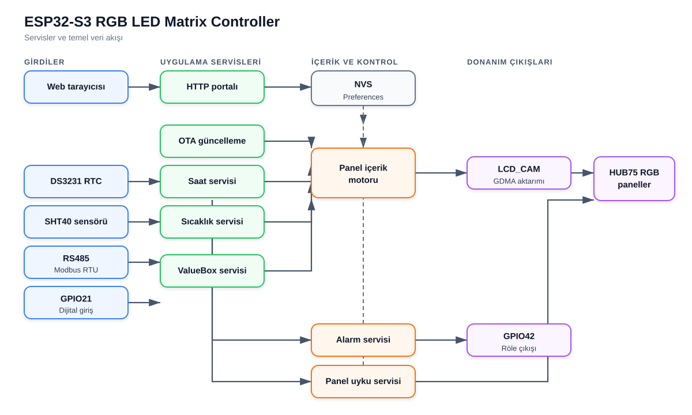

# ESP32-S3 RGB LED Matrix Controller

ESP32-S3 tabanlı, 32×16 HUB75/P10 RGB ve HUB12/P10 tek renk LED paneller için web arayüzlü kontrol cihazı firmware'idir. Proje; metin, saat, tarih, sıcaklık, nem, geri sayım ve dışarıdan alınan sayısal değerleri bir veya daha fazla panel üzerinde konumlandırabilir. İçerik ayarları sürükle-bırak web editörüyle hazırlanır ve ESP32-S3'ün kalıcı belleğinde saklanır.

Firmware aynı zamanda Modbus RTU slave, dijital giriş sayacı, DS3231 gerçek zaman saati, seçilebilir sıcaklık/nem sensörü (TMP112, SHT40, HDC2022), programlanabilir alarm rölesi ve okul zili (okul saati), panel uyku zamanlaması, Wi-Fi erişim noktası ve OTA güncelleme özelliklerini içerir.

## Proje durumu

| Özellik | Değer |
|---|---|
| Firmware sürümü | `0.17.0` |
| Mikrodenetleyici hedefi | ESP32-S3 |
| PlatformIO kartı | `esp32-s3-devkitc1-n8r2` |
| Önerilen modül | ESP32-S3-WROOM-1-N8R2 |
| Flash / PSRAM hedefi | 8 MB Flash / 2 MB PSRAM |
| Framework | Arduino |
| Panel boyutu | 32×16 piksel |
| Desteklenen tarama | RGB: 1/4 ve 1/8 scan; tek renk HUB12: 1/4 scan |
| En fazla yerleşim | 4 satır × 4 sütun, toplam 16 panel |
| Panel başına içerik | En fazla 2 TextBox/ValueBox |
| Web arayüzü dilleri | Türkçe, İngilizce, Almanca, İspanyolca, Arapça |

## Temel özellikler

- 32×16 HUB75/P10 RGB panel desteği
- 32×16 HUB12/P10 tek renk panel desteği; panel tipi Panel Ayarları'ndan seçilir, cihaz yeniden başlayıp seçilen modda çalışır
- ESP32-S3 LCD_CAM/GDMA tabanlı paralel panel çıkışı
- 1/4 scan `P10RGB-3535-DP-4S` özel piksel eşlemesi
- 1/8 scan standart iki taramalı panel eşlemesi
- 1×1 ile 4×4 arasında panel yerleşimi
- Sekiz farklı düz ve zigzag panel zincirleme yönü
- Web üzerinde gerçek font bitmap'leriyle piksel hassasiyetinde önizleme
- Sürükle-bırak TextBox ve ValueBox konumlandırma
- 59 Adafruit GFX fontu
- Her font için Türkçe karakterler ve `°` derece işareti; Almanca/İspanyolca harfler fonttan sentezlenir
- Saat, tarih, sıcaklık, nem ve metin arasında otomatik içerik döngüsü
- Dört yönde, engellemeyen kayar yazı
- 0°, 90°, 180° ve 270° kutu döndürme
- Kutu başına gösterim alanı: kendi paneline kırpma veya tüm ekran
- RGB renk ve kaydırma hızı ayarı
- DS3231 üzerinden pil destekli saat/tarih, STA bağlıyken isteğe bağlı NTP eşitleme
- TMP112, SHT40 veya HDC2022 ile sıcaklık; SHT40/HDC2022 ile nem ölçümü; sensöre özgü ayarlar ve kalibrasyon düzeltmesi
- Modbus RTU slave üzerinden ValueBox güncelleme; donanım RS485 yön kontrolü ve donanım çerçeve ayırma
- ValueBox için ondalık basamak/ondalık nokta kaydırma ve birim son eki
- GPIO12 yükselen kenar sayacı; ana döngüden bağımsız 1 ms örnekleme
- ValueBox değerlerinin elektrik kesintisine karşı flash'ta korunması (200 ms kontrol, aşınmayı dağıtan halka kayıt)
- En fazla 10 programlanabilir alarm
- Okul saati: 20 derse kadar ders ve teneffüs zilleri, öğrenci zili, Türkiye resmi tatilleri (yarım gün arifeler dahil), tatil dönemleri ve 10 Kasım saygı duruşu zili
- Geri sayım (örneğin sınav, toplantı veya yarışma süresi): saat/dakika/saniye süresi, web üzerinden Başlat/Durdur/Sıfırla, süre bitince ayarlanabilir süreyle alarm rölesi; elektrik kesintisinde DS3231 ile kaldığı yerden devam
- Zamanlanmış panel karartma/uyku işlevi
- AP+STA Wi-Fi, captive portal ve bağlantı durum göstergesi
- Cihaz yöneticisi sayfası: aynı ağdaki bütün cihazları imzayla bulur, paneli yakıp söndürerek tanıtır ve her cihazın arayüzünü tek sayfadan açar; her cihazın adı ve `step-rgb-xxxx.local` ağ adı vardır
- Web üzerinden `firmware.bin` OTA güncellemesi
- GitHub üzerinden çevrimiçi güncelleme: master dalına yapılan her push otomatik derlenir; cihaz yeni sürümü bulur ve kullanıcının onayıyla kurar, yeni firmware açılmazsa önceki sürüme döner
- İsteğe bağlı olarak yerel ağdan (STA) erişimde HTTP Digest girişi; kayıtlı parolalar tarayıcıya gönderilmez
- NVS/Preferences üzerinde kalıcı ayarlar ve eski şemaları otomatik yükseltme
- Watchdog ve art arda çöken açılışlarda fabrika ayarına dönüş koruması
- Web arayüzünden onaylı fabrika ayarlarına dönüş

## Sistem mimarisi



Görsel ayrı bir SVG dosyası olarak tutulur: [`docs/system-architecture.svg`](docs/system-architecture.svg). Böylece GitHub görünümü Mermaid sürümüne veya rich-display desteğine bağlı değildir.

Tüm uygulama servisleri Arduino `loop()` içinde işbirlikçi biçimde güncellenir. HUB75 taraması DMA tarafından yürütüldüğü için ağ, Modbus, sensör ve içerik işlemleri panel yenilemesini doğrudan durdurmaz.

## Gerekli donanım

Temel sistem için aşağıdaki parçalar gerekir:

- ESP32-S3-WROOM-1-N8R2 modülü veya eşdeğer ESP32-S3 kartı
- 32×16 HUB75/P10 RGB LED panel; 1/4 veya 1/8 scan
- HUB75 sinyalleri için tercihen iki adet `74AHCT245` seviye çevirici
- DS3231 RTC ve yedek pili
- Sıcaklık sensörü: TMP112 (yalnızca sıcaklık), SHT40 veya HDC2022 (sıcaklık ve nem)
- 3.3 V RS485 transceiver; örneğin ST3485 veya MAX3485 sınıfı
- Alarm çıkışı için MOSFET/transistörlü röle sürücüsü ve flyback diyodu
- Aktif buzzer veya uygun buzzer sürücü katı
- İki durum LED'i ve seri dirençleri
- Dijital giriş için koruma/şekillendirme devresi
- ESP32-S3 için kararlı 3.3 V güç kaynağı
- Panel sayısına ve parlaklığa uygun ayrı 5 V panel güç kaynağı

> HUB75 paneli ESP32-S3'ün 3.3 V regülatöründen beslemeyin. Panel ve kontrol kartı ayrı güç yolları kullanmalı, ancak GND ortak olmalıdır.

## Pin bağlantıları

Pinlerin tek yetkili kaynağı [`include/AppConfig.h`](include/AppConfig.h) dosyasıdır. PCB tasarımı değiştirilirse hem şema hem bu dosya birlikte güncellenmelidir.

### HUB75 panel sinyalleri

| HUB75 sinyali | ESP32-S3 GPIO | Açıklama |
|---|---:|---|
| R1 | GPIO4 | Üst yarı kırmızı veri |
| G1 | GPIO5 | Üst yarı yeşil veri |
| B1 | GPIO6 | Üst yarı mavi veri |
| R2 | GPIO7 | Alt yarı kırmızı veri |
| G2 | GPIO15 | Alt yarı yeşil veri |
| B2 | GPIO16 | Alt yarı mavi veri |
| A | GPIO17 | Satır adresi A |
| B | GPIO18 | Satır adresi B |
| C | GPIO8 | Satır adresi C |
| D | Bağlı değil | Desteklenen 1/4 ve 1/8 panellerde kullanılmıyor |
| E | Bağlı değil | Desteklenen panellerde kullanılmıyor |
| LAT / STB | GPIO9 | Latch/Strobe |
| OE | GPIO10 | Çıkış etkinleştirme, aktif LOW |
| CLK | GPIO11 | Piksel saat sinyali |
| GND | GND | Panel ile ortak referans |

Kütüphane adı `ESP32 HUB75 LED MATRIX PANEL DMA Display` olsa da ESP32-S3 tarafında çıkış grubu LCD_CAM/GDMA paralel çevre birimi üzerinden sürülür. Sabit I²S pinleri yoktur; yukarıdaki GPIO eşlemesi firmware tarafından açıkça verilir.

GPIO8'in `C` adres hattına atanması bilinçlidir. Sinyalleri GPIO numara sırasına göre yeniden dizmeyin.

### HUB12 tek renk panel sinyalleri

Kartta ikinci bir 8×2 konnektör HUB12 bağlantısı içindir. Ortak hatlar HUB75 ile aynı GPIO'yu kullanır; HUB12'nin veri hatları HUB75'in üst yarı veri hatlarına bağlıdır:

| HUB12 sinyali | Kartta bağlı olduğu hat | ESP32-S3 GPIO | Açıklama |
|---|---|---:|---|
| OE | OE | GPIO10 | Çıkış etkinleştirme; çoğu P10 modülde aktif HIGH |
| A | A | GPIO17 | Satır adresi A |
| B | B | GPIO18 | Satır adresi B |
| C | C | GPIO8 | 1/4 taramada hep LOW |
| CLK | CLK | GPIO11 | Piksel saat sinyali |
| LAT / STB | LAT | GPIO9 | Latch/Strobe |
| R | R1 | GPIO4 | Veri; çoğu P10 modülde aktif LOW |
| G | G1 | GPIO5 | İki renkli modüllerde yeşil; tek renkte kullanılmaz, “kapalı” seviyede tutulur |
| D | B1 | GPIO6 | 1/16 tarama adres hattı; desteklenen 1/4 modüllerde hep LOW |

HUB12 modunda aynı DMA sürücüsü kullanılır; farklı olan üç nokta vardır:

- **Polarite:** DMA kütüphanesi HUB75 kurallarıyla çalışır (veri HIGH = LED açık, OE LOW = çıkış açık). HUB12 modunda R1, G1 ve OE sinyalleri ESP32-S3'ün GPIO matrisinde donanımsal olarak ters çevrilir; işlemciye ek yük getirmez. Her iki ters çevirme Panel Ayarları'ndan ayrı ayrı kapatılabilir.
- **Tarama eşlemesi:** 32×16, 1/4 taramalı P10 modül her tarama satırında tek veri hattından 128 bit alır. Her 8 piksellik sütun bloğu için sırasıyla y+12, y+8, y+4 ve y satırlarının 8 pikseli gönderilir (Freetronics DMD kütüphanesiyle aynı sıra). DMA tarafında zincir tek bir geniş panel olarak tanımlanır (modül başına 128 piksel × 8 satır) ve yalnızca R1'e giden üst yarı kullanılır.
- **Latch zamanlaması:** DMA kütüphanesi LAT'ı satırın son pikseliyle birlikte, o piksel kaydırılmadan yarım saat önce yükseltir. HUB75 sürücü entegreleri LAT yüksekken kilitlediği için bu sorun olmaz; HUB12 modüllerdeki 74HC595 ise LAT'ın yükselen kenarında kilitlenir ve son biti kaçırır. Bu durumda her piksel bir yazmaç kayar ve her 8 piksellik bloğun en sağdaki pikseli dört satır yukarıda görünür. Bunu önlemek için her satır, verinin önünde ve arkasında birer dolgu pikseliyle gönderilir; LAT arkadaki dolgu pikseline denk gelir.
- **Renk:** Siyah dışındaki her renk LED'i yakar. Ara parlaklık seviyesi yoktur; parlaklık OE ile panelin tamamına uygulanır. DMA çerçevesi 2 bit renk derinliğiyle tutulur, böylece 16 modülde bile bellek kullanımı RGB'nin yarısıdır.

### I²C, RS485 ve yardımcı giriş/çıkışlar

| İşlev | GPIO | Harici bağlantı | Elektriksel davranış |
|---|---:|---|---|
| I²C SDA | GPIO1 | DS3231 SDA + sensör SDA | 3.3 V pull-up gerekir |
| I²C SCL | GPIO2 | DS3231 SCL + sensör SCL | 3.3 V pull-up gerekir |
| Buzzer | GPIO13 | Buzzer sürücü girişi | Aktif HIGH, açılışta kısa darbeler |
| AP istemci LED'i | GPIO14 | Direnç → LED → GND | Aktif HIGH, 1 saniye aralıkla yanıp söner |
| STA bağlantı LED'i | GPIO21 | Direnç → LED → GND | Aktif HIGH, 1 saniye aralıkla yanıp söner |
| Alarm rölesi | GPIO42 | Röle sürücü girişi | Aktif HIGH: HIGH röleyi çeker, LOW bırakır |
| Modbus RX | GPIO39 | RS485 transceiver `RO` | UART1 RX |
| Modbus TX | GPIO40 | RS485 transceiver `DI` | UART1 TX |
| Modbus DIR | GPIO41 | RS485 `DE` + `/RE` | UART RTS; HIGH gönderme, LOW alma |
| Dijital sayaç | GPIO12 | Korunmuş dijital giriş | Dahili pull direnci yok; harici pull-down + 100 nF, LOW→HIGH sayımı |

### Programlama ve ayrılması gereken pinler

| İşlev | GPIO | Not |
|---|---:|---|
| USB D− | GPIO19 | Native USB Serial/JTAG |
| USB D+ | GPIO20 | Native USB Serial/JTAG |
| UART0 TX | GPIO43 | Programlama/debug için ayırılabilir |
| UART0 RX | GPIO44 | Programlama/debug için ayırılabilir |
| BOOT | GPIO0 | Pull-up ve GND'ye buton önerilir |
| CHIP_PU / EN | EN | Pull-up, RC gecikme ve reset butonu gerekir |

GPIO0, GPIO3, GPIO45 ve GPIO46 strapping pinleridir. Açılış seviyelerini bozacak güçlü harici sürücüler bağlanmamalıdır. GPIO26–32 Flash/PSRAM için ayrılmıştır. Modül ve bellek çeşidine göre GPIO33–37 de Flash/PSRAM tarafından kullanılabilir.

GPIO39–42 bu projede RS485 ve röle için kullanıldığı için harici pad-JTAG kullanılamaz. GPIO19/20 üzerindeki native USB Serial/JTAG kullanılmaya devam edebilir.

## PCB tasarım notları

### HUB75 çıkışı

- ESP32-S3 GPIO seviyesi 3.3 V'tur. Panel sinyalleri için 5 V ile beslenen `74AHCT245` kullanılması önerilir.
- On iki çıkış sinyali için iki adet sekiz kanallı buffer yeterlidir.
- Buffer yönünü ESP32-S3'ten panele sabitleyin ve kullanılmayan girişleri boşta bırakmayın.
- `OE` aktif LOW olduğu için açılış sırasında paneli kapalı tutacak bir pull-up planlayın.
- `CLK`, `LAT` ve `OE` hatlarında sürücüye yakın `22–47 Ω` seri direnç ayırmak ringing/EMI sorunlarını azaltabilir.
- Panel güç girişine yakın yeterli bulk kapasitör kullanın. Değer, panel sayısı ve maksimum akıma göre hesaplanmalıdır.
- HUB75 konnektörünün fiziksel pin numaralarını yalnızca panel üzerindeki sinyal isimleriyle doğrulayın; farklı üreticilerde konnektör yönü değişebilir.

### I²C

- SDA ve SCL için birer takım yaklaşık `4.7 kΩ` pull-up kullanın.
- Pull-up dirençleri 3.3 V'a bağlanmalıdır.
- Hazır DS3231 modüllerindeki pull-up dirençlerinin 5 V'a bağlı olup olmadığını kontrol edin.
- DS3231 adresi `0x68`tir. Sensör adresleri: TMP112 `0x48`–`0x4B` (X2SON TMP112D varyantında `0x40`–`0x43`), SHT40 `0x44`/`0x45`, HDC2022 `0x40`/`0x41`. Hiçbiri DS3231 ile çakışmaz.
- TMP112 adresi ADD0 pininin bağlandığı yere (GND, V+, SDA, SCL), HDC2022 adresi ADDR pinine (GND veya boşta `0x40`, VDD `0x41`) göre belirlenir. SHT40 adresi ürün kodundaki AD1B/BD1B sürümüyle sabittir.

### RS485

- 3.3 V ile çalışan bir RS485 transceiver kullanın.
- GPIO40 → `DI`, GPIO39 ← `RO`, GPIO41 → `DE` ve `/RE` bağlantısı yapılır. GPIO41, UART1'in RTS çıkışı olarak donanım RS485 modunda sürülür.
- GPIO41'e yaklaşık `10 kΩ` pull-down eklemek, ESP32-S3 başlatılana kadar transceiver'ı alıcı modunda tutar.
- Hat sonundaysa seçilebilir `120 Ω` terminasyon direnci ekleyin.
- Bias dirençlerini ağ üzerinde yalnızca gerekli noktada kullanın; her cihaza zorunlu olarak eklemeyin.
- A/B konnektöründe GND referansı ve ESD/TVS koruması ayırın.

### Röle, buzzer ve dijital giriş

- Röle bobinini GPIO42'ye doğrudan bağlamayın. Röle, GPIO42 HIGH olduğunda çekecek şekilde sürülür; MOSFET/transistör, gate/base direnci, pull-down ve flyback diyodu kullanın.
- GPIO42'ye harici pull-down ekleyin. ESP32 açılırken, yeniden başlarken ve OTA sonrası pin bir süre boşta kalır; pull-down bu sırada röleyi bırakılmış tutar.
- Buzzer akımı GPIO sınırını aşıyorsa GPIO13'ü yalnızca sürücü girişi olarak kullanın.
- GPIO12 yalnızca 3.3 V lojik seviyeyi kabul etmelidir. Firmware dahili pull direnci kullanmaz; giriş hiçbir zaman boşta kalmamalı, boştaki LOW seviyesini harici pull-down sağlamalıdır. Boşta kalan giriş gürültüyü darbe olarak sayar. Harici saha girişi için seri direnç, 100 nF filtre kondansatörü, Schmitt trigger/optoizolasyon ve ESD koruması değerlendirilmelidir.

### ESP32-S3 besleme, USB ve anten

- ESP32-S3 3.3 V kaynağı en az 500 mA sağlayabilmelidir; Wi-Fi akım darbeleri için pay bırakın.
- Güç girişinde en az `10 µF`, modül yakınında uygun `100 nF` ve ek bulk kapasitörler kullanın.
- `EN/CHIP_PU` boşta bırakılmamalıdır. Tipik başlangıç noktası `10 kΩ` pull-up ve `1 µF` GND kondansatörüdür.
- USB D+/D− hatlarında modüle yakın `22/33 Ω` seri direnç ve konnektöre yakın ESD koruması ayırın.
- USB-C device tasarımında CC1 ve CC2 pinlerinin her birine ayrı `5.1 kΩ` GND direnci gerekir.
- WROOM PCB antenini kart kenarına yerleştirin. Anten altında/önünde tüm katmanlarda bakır, iz ve komponent keep-out alanı bırakın.

Başvuru belgeleri:

- [ESP32-S3 Hardware Design Guidelines](https://docs.espressif.com/projects/esp-hardware-design-guidelines/en/latest/esp32s3/)
- [ESP32-S3 GPIO açıklamaları](https://docs.espressif.com/projects/esp-idf/en/stable/esp32s3/api-reference/peripherals/gpio.html)
- [ESP32-S3-WROOM-1 / WROOM-1U datasheet](https://documentation.espressif.com/esp32-s3-wroom-1_wroom-1u_datasheet_en.pdf)

## Varsayılan çalışma ayarları

İlk açılışta veya fabrika ayarına dönüşten sonra aşağıdaki değerler kullanılır:

| Ayar | Varsayılan |
|---|---|
| Panel tipi | RGB HUB75 |
| Panel tarama | Derleme sırasındaki `PANEL_SCAN_DIVISOR`, varsayılan 1/4 |
| Panel yerleşimi | 1 satır × 1 sütun |
| Panel bağlantı yönü | Sağ üstten aşağı |
| Parlaklık | 64 / 255 |
| Başlangıç içeriği | Kırmızı saat |
| Saat konumu | X=1, Y=3 |
| Varsayılan font | GohuFont6x11 |
| Sıcaklık sensörü | TMP112, `0x48`, 4 Hz, 2 saniye ölçüm aralığı; önceki sürümden yükseltilen cihazlarda SHT40 korunur |
| AP SSID | `STEP-RGB` |
| AP parolası | `00000000` |
| AP adresi | `192.168.4.1` |
| AP kanalı | 1 |
| En fazla AP istemcisi | 4 |
| STA | Devre dışı; SSID boş |
| Modbus slave adresi | 1 |
| Modbus seri ayarı | 115200 baud, 8N1 |
| RS485 yön kontrolü | Etkin |
| Panel uyku zamanı | Devre dışı; kayıtlı varsayılan aralık 23:00–07:00 |
| NTP eşitleme | Devre dışı; `pool.ntp.org`, saat dilimi UTC+3 (`<+03>-3`) |
| Yerel ağ (STA) portal girişi | Kapalı; açılırsa kullanıcı `admin`, parola AP parolası |
| Alarmlar | Boş |
| Alarm modu | Manuel alarm |
| Cihaz adı | `STEP-RGB-XXXX` (XXXX: MAC adresinin son dört hanesi) |
| Çevrimiçi güncelleme denetimi | Açık, günde bir kez |
| Kayıtlı ValueBox değerleri | Yok; kutular başlangıç değerinden başlar |
| Dijital giriş debounce | 10 ms |
| Seri monitör | 115200 baud |
| Watchdog | 20 saniye |

Varsayılan AP parolası yalnızca ilk kurulum içindir ve cihaz devreye alınmadan önce web arayüzünden değiştirilmelidir; varsayılan parola kullanıldığı sürece Wi-Fi ayarlarında uyarı gösterilir.

## İlk kurulum

1. Donanım bağlantılarını ve özellikle ortak GND'yi kontrol edin.
2. Firmware'i USB veya UART üzerinden ESP32-S3'e yükleyin.
3. Telefon/bilgisayardan `STEP-RGB` Wi-Fi ağına bağlanın.
4. Varsayılan parola olarak `00000000` kullanın.
5. Captive portal otomatik açılmazsa `http://192.168.4.1/` adresini açın.
6. Ayarlar sayfasından panel scan oranını, satır/sütun sayısını ve fiziksel zincirleme yönünü seçin.
7. Kırmızı, yeşil ve mavi panel testlerini çalıştırarak renk/sinyal bağlantılarını doğrulayın.
8. AP parolasını değiştirin; ardından saat/tarih (veya NTP), Wi-Fi STA, Modbus ve alarm ayarlarını yapılandırın.
9. Ana editörden TextBox/ValueBox öğelerini ekleyip panele uygulayın.

Panel tarama/yerleşim, Wi-Fi ve haberleşme gibi donanım seviyesini etkileyen ayarlar kaydedildikten sonra cihaz kontrollü olarak yeniden başlar. Yalnızca parlaklık değiştiyse ayar yeniden başlatmadan hemen uygulanır. Satır/sütun sayısı azaltıldığında mevcut tasarım yeni yerleşime sığmıyorsa kaydetme yanıtı bunu bildirir; yeniden başlatmada varsayılan tasarım yüklenir.

## Web arayüzü

### Ana içerik editörü

Ana sayfa aşağıdaki işlemleri sağlar:

- Fiziksel panel yerleşiminin görsel önizlemesi
- Düzenlenecek panelin seçilmesi
- TextBox veya ValueBox eklenmesi
- Öğenin fare veya dokunmatik ekranla sürüklenmesi
- Font, renk, dönüş, konum, gösterim alanı ve kaydırma ayarı
- Panel başına doluluk göstergesi
- Tasarımın flash belleğe kaydedilmesi
- Panele uygulanmış geri sayımın başlatılması, durdurulması ve sıfırlanması

Her kutunun **gösterim alanı** seçilebilir. “Yalnızca kendi paneli” seçildiğinde kutu kendi panelinin dışında kırpılır ve kayar yazı panelin kenarlarında döner; komşu paneldeki kutularla üst üste binmez. “Tüm ekran” seçildiğinde yazı bütün ekranda kayar. Yeni kutular kendi paneliyle başlar; 0.9.x sürümünden yükseltilen tasarımlar eski davranışı korumak için “Tüm ekran” olarak taşınır. Önizleme aynı kırpmayı gösterir.

Editör önizlemesi fontları tarayıcı sistem fontlarıyla taklit etmez. Cihazdaki gerçek Adafruit GFX bitmap ve glif metrikleri `/api/font` üzerinden alınır; bu nedenle web önizlemesi ile fiziksel panel konumu aynı koordinat sistemini kullanır.

### TextBox

TextBox aşağıdaki içerik türlerini gösterebilir:

- Sabit metin
- Saat
- Tarih
- Sıcaklık
- Nem (SHT40 veya HDC2022 seçiliyken)
- Geri sayım (içerik döngüsüne eklenemez)

İçerik döngüsü etkinleştirilirse seçilen türler `Yazı → Saat → Tarih → Sıcaklık → Nem` sırasıyla gösterilir. Geçiş süresi 1–3600 saniye arasında seçilebilir. Kayar yazı açıkken geçiş süresi dolduktan sonra içerik, mevcut yazı gösterim alanından tamamen çıktığında değişir; yeni içerik yazının yeniden gireceği kenardan kayarak girer, böylece yazının konumu sıçramaz. Döngüdeki bilgiler kutunun kendi veri türüne göre ortalanır; bu tür döngüden çıkarılırsa ilk seçili tür esas alınır. Ortalamada esas alınan içeriğin yalnızca gösterim alanı içinde kalan kısmı hesaba katılır, böylece ekrandan uzun bir metin diğer bilgileri ekran dışına itmez.

Metin alanının dahili kapasitesi 48 byte'tır; sonlandırıcı nedeniyle kullanıcı metni en fazla 47 UTF-8 byte olabilir. Türkçe karakterlerin birden fazla UTF-8 byte kullanabileceği unutulmamalıdır.

### Geri sayım

TextBox veri türü **Geri Sayım** seçildiğinde kutu ayarlanan süreden sıfıra doğru sayar. Sınav, toplantı, sunum, yarışma veya mola gibi süresi belli her etkinlikte kullanılabilir.

- **Süre:** Saat (0–23), dakika (0–59) ve saniye (0–59) olarak girilir; en az 1 saniye, en fazla 23:59:59 olabilir.
- **Gösterim:** Biçimi ayarlanan süre belirler; böylece sayım boyunca yazının genişliği değişmez. Süre 1 saat veya daha uzunsa `1:05:00`, 1 saatten kısaysa `40:00`, 1 dakikadan kısaysa yalnızca saniye (`45`) gösterilir. Kalan süre yukarı yuvarlanır: başlangıçta tam süre görünür, `00` yalnızca süre dolduğunda görünür.
- **Alarm (röle) süresi:** Sayım sıfıra ulaştığında GPIO42 alarm rölesi 0–3600 saniye çalışır; 0 alarmı kapatır.
- **İçerik döngüsü:** Geri sayım döngüye eklenemez; Geri Sayım seçili kutuda döngü anahtarı kapalıdır.

Tasarım panele uygulandıktan sonra ana sayfanın üstünde **Geri Sayım** kartı görünür. Kart, kutuların kalan süresini ve sayım durumunu gösterir:

| Düğme | İşlev |
|---|---|
| Başlat / Devam Et | Sayımı başlatır; durdurulmuş sayımı kaldığı yerden sürdürür. Süre dolduktan sonra “Yeniden Başlat” olarak yeni bir sayım başlatır. |
| Durdur | Sayımı duraklatır ve çalan geri sayım alarmını susturur. |
| Sıfırla | Sayımı tam süreye döndürür ve alarmı susturur. Sayım sürerken veya durdurulmuşken onay istenir. |

Tasarımdaki bütün Geri Sayım kutuları tek bir oturumla birlikte başlar ve durur. Her kutu kendi süresini sayar ve kendi sıfırında, kendi alarm süresiyle röleyi bir kez çalıştırır; örneğin 40 ve 60 dakikalık iki kutu aynı anda başlatılabilir. Programlanmış alarmlar ile geri sayım alarmı aynı röleyi kullanır; Durdur ve Sıfırla programlanmış alarmı kesmez.

Sayım durumu yalnızca düğmelere basıldığında ve sayım bittiğinde NVS'ye (`countdown` namespace'i) yazılır. Sayım sürerken elektrik kesilirse cihaz açıldığında kesintide geçen süre DS3231 saatine göre eklenir ve sayım devam eder; kesinti sırasında sıfıra ulaşan kutular açılışta alarm çalmaz. DS3231 yoksa veya saati geçersizse sayım durdurulmuş olarak açılır ve kullanıcının **Devam Et** düğmesine basması beklenir. Sayım sürerken tasarım yeniden uygulanırsa sayım kesilmez; geçen süre kutuların yeni süreleriyle karşılaştırılır.

### ValueBox

ValueBox iki kaynaktan değer alabilir:

1. Modbus RTU holding register
2. GPIO12 dijital giriş sayacı

Modbus kaynağında signed 16-bit integer veya IEEE-754 float seçilebilir. Dijital giriş kaynağında yukarı/aşağı sayma ve 32-bit başlangıç değeri ayarlanabilir. Değişen değerler flash'a kaydedilir; cihaz yeniden başladığında veya elektrik geldiğinde her ValueBox son değeriyle devam eder (bkz. [Elektrik kesintisinde değerlerin korunması](#elektrik-kesintisinde-değerlerin-korunması)).

Tasarım kaydedildiğinde veri kaynağı (kaynak türü, register adresi/değer tipi) ve başlangıç değeri değişmeyen ValueBox'lar mevcut değerlerini korur; kutuyu taşımak, rengini veya fontunu değiştirmek ya da yeni kutu eklemek sayacı sıfırlamaz. Kaynağı veya başlangıç değeri değişen kutu başlangıç değerinden yeniden başlar.

Gösterim seçenekleri:

- **Ondalık basamak (0–3):** Float değer bu basamağa yuvarlanır. Integer ve sayaç değerlerinde ondalık nokta kaydırılır; örneğin register değeri `1234` ve 2 basamak `12.34` olarak gösterilir.
- **Birim / son ek:** Değerin sonuna eklenir, örneğin `°C` veya ` bar`. En fazla 15 UTF-8 bayttır ve TextBox ile aynı karakter kümesini kullanır.

#### Elektrik kesintisinde değerlerin korunması

Tasarımda en az bir ValueBox varsa firmware değerleri her 200 ms'de kontrol eder ve son kayıttan beri değişen her ValueBox'ın değerini flash'a yazar. Açılışta her kutu kayıtlı son değeriyle devam eder. Elektrik kesildiğinde en fazla son 200 ms içindeki değişiklik kaybolur. Sayaç darbeleri ve Modbus ile yazılan değerler aynı şekilde korunur.

- **Kayıt alanı:** Varsayılan 8 MB bölüm tablosundaki 1,5 MB'lık `spiffs` veri bölümü. Firmware bu bölümü başka bir iş için kullanmaz. Bölüm tablosu değişmediği için özellik OTA ile güncellenen cihazlarda da çalışır.
- **Kayıt düzeni:** Her değer 16 baytlık bir kayıttır: kutu sırası, kaynak özeti, değer ve CRC32. Kayıtlar bölüm boyunca halka şeklinde art arda yazılır, aynı flash adresi tekrar tekrar silinmez. 4 KB'lık bir sektör dolunca sıradaki sektör silinir ve önce bütün güncel değerlerin bir kopyası yazılır. Böylece en eski sektör silindiğinde uzun süredir değişmeyen bir değer kaybolmaz.
- **Kesinti güvenliği:** Kayıt yazılırken elektrik kesilirse yarım kalan kayıt CRC ile ayıklanır ve kutu bir önceki değerle açılır. Sektör silinirken veya kopya yazılırken kesilirse bir önceki sektör kullanılır.
- **Hangi değer geri gelir:** Kayıtlı değer, kutunun kaynağı (kaynak türü, register adresi/değer tipi) ve başlangıç değeri kayıt anındakiyle aynıysa geri yüklenir. Bu, tasarım kaydında değerin korunma kuralıyla aynıdır. Bir sayacı sıfırlamak için başlangıç değerini değiştirip tasarımı kaydedin.
- **USB:** Normal USB yükleme ve OTA güncelleme kayıtlı değerlere dokunmaz. "Erase Flash" yapılırsa değerler de silinir.

Flash ömrü: Bölüm 384 sektördür ve her sektör yaklaşık 100.000 silme döngüsüne dayanır. Tahmini ömür, ne kadar ValueBox'ın ne sıklıkla değiştiğine bağlıdır:

| Kullanım | Sektör başına silme | Tahmini ömür |
|---|---:|---:|
| Her 200 ms'de değişen 1 sayaç | ~4,4 / gün | ~60 yıl |
| Her saniye değişen 10 Modbus değeri | ~9 / gün | ~30 yıl |
| Her 200 ms'de değişen 10 ValueBox | ~46 / gün | ~6 yıl |
| Her 200 ms'de değişen 32 ValueBox (en kötü durum) | ~160 / gün | ~1,7 yıl |

### Ayarlar sayfası

Ayarlar ekranı şu grupları içerir:

- Panel tipi (RGB HUB75 veya tek renk HUB12), tarama, boyut, parlaklık ve zincirleme yönü; tek renk seçildiğinde HUB12 veri ve OE polaritesi ayarlanabilir, tarama 1/4'e sabitlenir
- RGB panel testi
- DS3231 saat/tarih ayarı; alanlar cihaz saatiyle canlı ilerler
- Telefon/bilgisayar saatini kullanma
- NTP sunucusu ve saat dilimi
- Panel uyku zamanlaması; saat ayarından bağımsız kaydedilir
- Alarm listesi
- UART/Modbus haberleşme ayarları
- Cihaz adı (cihaz yöneticisinde görünen ad), Wi-Fi AP ve STA ayarları
- STA bağlantı durumu, IP ve sinyal kalitesi
- OTA firmware güncellemesi
- Fabrika ayarlarına dönüş (Yazılım Güncelleme sekmesinde)

#### Fabrika ayarlarına dönüş

Ayarlar → Yazılım Güncelleme sekmesinin altındaki **Fabrika Ayarlarına Dön** düğmesi, tarayıcıda onay aldıktan sonra cihazı fabrika ayarlarına döndürür ve yeniden başlatır:

- Panel, Wi-Fi (AP ve STA), haberleşme, NTP, sensör, alarm, okul saati, panel uyku, cihaz adı ve içerik tasarımı varsayılanlara döner.
- Flash'ta tutulan ValueBox değerleri silinir, geri sayım sıfırlanır ve çevrimiçi güncellemenin otomatik denetimi yeniden açılır.
- Firmware sürümü, DS3231 saati ve boot guard sayaçları değişmez.
- Wi-Fi ayarları da sıfırlandığı için cihaz yeniden başladıktan sonra varsayılan `STEP-RGB` ağına `00000000` parolasıyla bağlanmak gerekir.
- Çevrimiçi güncelleme indirilirken veya kurulurken fabrika ayarlarına dönülemez.

### Dil desteği

Web arayüzü Türkçe, İngilizce, Almanca, İspanyolca ve Arapça dillerini destekler. İlk açılışta desteklenen tarayıcı dili algılanır. Seçim tarayıcının `localStorage` alanında saklanır; farklı telefon veya bilgisayarlarda dil tercihi ayrı olabilir.

Cihazın gönderdiği bütün hata ve onay mesajları da beş dilde çevrilir. `node tools/generate_portal_compressed.mjs`, `UI_TEXT(...)` ile işaretli bir firmware mesajının veya sayfadaki bir metnin çevirisi eksikse portalı üretmeyi reddeder.

Arapçada sayfa RTL düzenine geçer. Panel koordinat sistemi, bağlantı şekilleri, sayısal alanlar ve piksel önizlemesi teknik doğruluğu korumak için LTR kalır.

## Font sistemi

Firmware toplam 59 font içerir:

- Apple4x6, Apple5x7, Apple6x10, Apple8x13
- GohuFont6x11 ve GohuFont6x11b
- Fixed
- FreeMono ailesi; normal, bold ve oblique, 9/12/18/24 pt
- FreeSans ailesi; normal, bold ve oblique, 9/12/18/24 pt
- FreeSerif ailesi; normal, bold ve italic, 9/12/18/24 pt
- Org_01, Picopixel, Tiny3x3a2pt7b ve TomThumb

Her fontun `Ç Ğ İ Ö Ş Ü ç ğ ı ö ş ü` karakterleri ve derece işareti fonta özgü bitmap olarak üretilmiştir. `℃` karakteri derece glifi ile `C` karakterinin birleşimi şeklinde gösterilir. Küçük bitmap fontlarda (Apple, Gohu, Fixed, Org_01, Picopixel, Tiny3x3, TomThumb) derece işareti fontun rakam yüksekliğine göre boyutlanan kapalı bir halka olarak çizilir ve üstü rakamların/büyük harflerin üst hizasına oturtulur; FreeFont ailelerinde fontun kendi `°` glifi kullanılır.

Almanca ve İspanyolca için `Ä ä Á á É é Í í Ó ó Ú ú Ñ ñ ¡ ¿` karakterleri çalışma anında her fontun kendi temel harfinden ve çizgi kalınlığından sentezlenir (`Ö Ü ö ü` zaten Türkçe kümede vardır). `ß`, resmi yazım karşılığı olan `ss` olarak gösterilir. Desteklenmeyen karakterler `?` olarak görünür; Arapça harfler panelde gösterilemez (web arayüzü Arapça kullanılabilir).

Font kataloğu [`lib/Fonts/FontCatalog.cpp`](lib/Fonts/FontCatalog.cpp), üretilmiş Türkçe glifler ise [`lib/Fonts/FontTurkishExtensions.generated.h`](lib/Fonts/FontTurkishExtensions.generated.h) içindedir.

Türkçe font uzantılarını yeniden üretmek için GNU FreeFont TTF dosyaları ve Pillow gerekir:

```bash
python tools/generate_turkish_font_extensions.py \
  --freefont-dir /path/to/freefont-ttf \
  --preview /tmp/font-preview.png
```

`FontTurkishExtensions.generated.h` dosyası elle düzenlenmemelidir. Fonta özgü düzeltmeler üretici betiğine eklenmeli, ardından başlık yeniden üretilmelidir.

## Modbus RTU slave

### Fiziksel bağlantı

| RS485 transceiver | ESP32-S3 |
|---|---|
| RO | GPIO39 / UART1 RX |
| DI | GPIO40 / UART1 TX |
| DE + `/RE` | GPIO41 / DIR |

### Varsayılan iletişim

- Slave ID: `1`
- Baudrate: `115200`
- Veri formatı: `8N1`
- Stop bit: sabit `1`
- Yön kontrolü: GPIO41, UART donanım RS485 yarı-çift yönlü modunda RTS olarak sürülür

Web arayüzünün **Haberleşme Ayarları** bölümünde Slave ID `1–247` aralığında elle girilebilir. Aynı bölümden baudrate `4800`, `9600`, `19200`, `57600` veya `115200`; data size 5–8 bit; parity None/Even/Odd olarak seçilebilir. Ayarlar NVS içinde saklanır ve kayıt sonrasında cihaz yeni iletişim ayarlarıyla yeniden başlar.

### Desteklenen fonksiyonlar

| Fonksiyon | Kod | Davranış |
|---|---:|---|
| Read Holding Registers | `0x03` | ValueBox register değerlerini okur |
| Write Single Register | `0x06` | Tek register yazar |
| Write Multiple Registers | `0x10` | Ardışık register yazar |

Çerçeve sonu UART donanımının RX zaman aşımıyla algılanır (en az 3.5 karakter, yüksek baudrate'lerde en az 2 ms sessizlik). Böylece ana döngü web isteği işlerken bile ardışık çerçeveler birbirine karışmaz. Alınan çerçeveler kuyruğa alınır ve ana döngüde işlenir; kuyrukta 250 ms'den uzun bekleyen istekler, bir sonraki bus döngüsüyle çakışabilecek geç cevap yerine atılır. Cevap gönderimi ana döngüyü bloklamaz; DIR hattını UART donanımı son stop bitinden sonra bırakır.

Donanım yön kontrolü beklendiği gibi çalışmazsa `include/AppConfig.h` içindeki `Modbus::hardwareDirectionControl` değeri `false` yapılarak 0.9.x sürümündeki yazılımsal DIR kontrolüne dönülebilir.

Bir okumada/yazmada en fazla 64 register işlenir. Standart Modbus exception kodları kullanılır:

- `0x01`: Illegal Function
- `0x02`: Illegal Data Address
- `0x03`: Illegal Data Value

Adres `0` broadcast yazmaları kabul edilir ve broadcast isteğine cevap gönderilmez. Broadcast read isteği işlenmez.

### Register eşlemesi

Firmware'de sabit, global bir register tablosu yoktur. Her Modbus ValueBox için holding register adresi web editöründe kullanıcı tarafından seçilir.

| ValueBox tipi | Kullanılan register | Veri gösterimi |
|---|---:|---|
| Signed integer 16-bit | 1 | İki tamamlayan signed `int16_t` |
| IEEE-754 float | 2 | İlk register yüksek word, ikinci register düşük word |

Float değerlerde word sırası `High Word → Low Word` şeklindedir. Her Modbus register içindeki byte sırası standart Modbus big-endian düzenindedir. Float ValueBox adresi `65535` olamaz ve iki ValueBox register aralığı çakışamaz.

Örnek: float ValueBox başlangıç adresi `100` ise:

- Register `100`: IEEE-754 bitlerinin üst 16 biti
- Register `101`: IEEE-754 bitlerinin alt 16 biti

Modbus ile yazılan değer de flash'a kaydedilir. Yeniden başlatmada ValueBox son yazılan değerle devam eder (bkz. [Elektrik kesintisinde değerlerin korunması](#elektrik-kesintisinde-değerlerin-korunması)).

## Dijital giriş sayacı

GPIO12'de dahili pull direnci kullanılmaz; boştaki LOW seviyesini kart üzerindeki harici pull-down sağlar, 100 nF kondansatör kontak sıçramalarını yumuşatır. Giriş, ana döngüden bağımsız bir `esp_timer` geri çağrısıyla her 1 ms'de örneklenir; web sayfası sunulurken veya ana döngü meşgulken gelen darbeler kaçmaz. Flash silme işlemleri sırasında (ValueBox kayıt alanında sektör değişimi, ayar kaydı, OTA) örnekleme birkaç on milisaniye durabilir. Debounce süresi 10 ms'dir; bir darbenin sayılması için girişin en az 10 ms LOW ve ardından 10 ms HIGH kalması gerekir (en fazla yaklaşık 45 darbe/saniye). Kararlı bir `LOW → HIGH` kenarı geldiğinde dijital giriş kaynağını kullanan ValueBox öğeleri yön ayarına göre bir artırılır veya azaltılır.

- Sayaç türü: signed 32-bit
- Aralık: `-2147483648` … `2147483647`
- Taşma yerine sınırda durur
- Negatif değerler panelde gösterilebilir
- Birden fazla dijital ValueBox aynı fiziksel kenarı birlikte işler
- Tasarım kaydedildiğinde başlangıç değeri değişmeyen sayaçlar değerini korur
- Son değer elektrik kesintisinde korunur

## Saat, sıcaklık, alarm ve panel uyku işlevi

### DS3231

DS3231 her 100 ms'de bir okunur. RTC bulunamazsa saat, alarm ve zamanlamaya bağlı işlevler hazır duruma geçmez. RTC güç kaybı algılanırsa ilk açılışta firmware derleme tarih/saatine ayarlanır; daha sonra web arayüzünden doğru zaman girilmeli veya NTP açılmalıdır.

Ayarlar sayfasındaki tarih/saat alanları cihaz saatiyle birlikte canlı ilerler; elle girilen değer de kaydedilene kadar saymaya devam eder. Böylece sayfa uzun süre açık kaldıktan sonra kaydetmek RTC'yi geri almaz.

### NTP

NTP açıksa cihaz STA ağına her bağlandığında SNTP istemcisini başlatır ve gelen zamanı seçilen POSIX saat dilimine (yaz saati kurallarıyla) çevirip DS3231'e yazar. SNTP eşitlemesi saatte bir yenilenir; RTC en fazla dakikada bir yazılır. Ayarlar sayfasında hazır saat dilimleri ve özel POSIX TZ değeri seçilebilir. NTP açıkken elle girilen saat bir sonraki eşitlemede düzeltilir.

### Sıcaklık ve nem sensörü

Karta üç sensörden biri takılabilir; model **Ayarlar → Sıcaklık Sensörü** bölümünden seçilir ve kaydedildiğinde yeniden başlatmadan uygulanır. Yeni cihazlarda ve fabrika ayarında TMP112 seçilidir; daha önce SHT40 ile kurulmuş cihazlar güncellemeden sonra SHT40 ile çalışmaya devam eder. Sürücüler TI ve Sensirion datasheet'lerine göre yazılmıştır: [`lib/TMP112`](lib/TMP112/src/TMP112.cpp), [`lib/SHT40`](lib/SHT40/src/SHT40.cpp), [`lib/HDC2022`](lib/HDC2022/src/HDC2022.cpp).

| Sensör | Ölçüm | I²C adresi | Sensöre özgü ayarlar | Algılama |
|---|---|---|---|---|
| TMP112 | Sıcaklık, 0.0625 °C çözünürlük | `0x48`–`0x4B`, X2SON TMP112D: `0x40`–`0x43` | Dönüşüm hızı 0.25/1/4/8 Hz, genişletilmiş aralık (13 bit, 150 °C'ye kadar) | Yapılandırma registerının salt okunur R1:R0 bitleri |
| SHT40 | Sıcaklık ve nem | `0x44` (AD1B), `0x45` (BD1B) | Ölçüm hassasiyeti yüksek/orta/düşük (en fazla 8.2/4.5/1.7 ms) | CRC korumalı seri numara okuması |
| HDC2022 | Sıcaklık ve nem | `0x40` (ADDR → GND/boşta), `0x41` (ADDR → VDD) | Sıcaklık ve nem çözünürlüğü 14/11/9 bit | Üretici kimliği `0x5449`, cihaz kimliği `0x07D0` |

Tüm sensörler için ortak ayarlar:

- Ölçüm aralığı: 1–60 saniye (varsayılan 2 saniye)
- Sıcaklık düzeltmesi: −10.0…+10.0 °C
- Nem düzeltmesi: −20.0…+20.0 %RH (yalnızca nem ölçen sensörlerde)

SHT40 ve HDC2022 her aralıkta tek seferlik ölçüm başlatır; TMP112 seçilen hızda sürekli ölçer ve son sonuç okunur. Tek bir I²C hatasında son değer korunur; art arda üç hatada sensör kayıp sayılır ve 10 saniyede bir yeniden aranır.

Seçili sensör bulunamazsa sıcaklık ve nem içeriğinde sensöre göre `TMP?`, `SHT?` veya `HDC?` gösterilir. Ayarlar sayfası sensörün bulunup bulunmadığını, adresini ve anlık ölçümü gösterir.

Sıcaklık ve nem iki biçimde gösterilebilir:

- Bir ondalıklı, örneğin `23.5°C` ve `45.3%`
- En yakın tam sayıya yuvarlanmış, örneğin `24°C` ve `45%`

**TMP112 ve nem:** TMP112 nem ölçmez. Bu sensör seçiliyken editörde “Nem” veri türü ve döngüdeki “Nem” seçeneği kapalıdır; nem gösteren bir tasarım kaydedilemez ve tasarımda nem kutusu varken sensör TMP112'ye alınamaz. Bu kontroller herhangi bir şekilde aşılırsa panel nem yerine `--%` gösterir.

### Alarm

Ayarlar → Alarm Ayarları bölümünde iki mod vardır: **Manuel alarm** ve **Okul saati**. Aynı anda yalnızca seçili mod çalışır; diğer modun ayarları silinmez, mod değiştirilip kaydedildiğinde yeniden kullanılır.

Manuel alarm:

- En fazla 10 alarm
- 1–3600 saniye röle aktif kalma süresi
- Her gün, hafta içi veya kullanıcı tarafından seçilen günler
- Aynı alarm aynı takvim gününde bir kez tetiklenir

Her iki modda:

- Çakışan zil/alarm sürelerinde röle kapanış zamanı daha ileri olana uzatılır
- Geri sayım aynı röleyi kullanır; röle, programlanmış alarm veya geri sayım alarmından biri sürdükçe açık kalır
- **Zili Test Et** düğmesi röleyi hemen çalıştırır (okul saatinde zil süresi kadar, en fazla 30 saniye; manuel modda 3 saniye)
- GPIO42 aktif HIGH çalışır: HIGH röleyi çeker, LOW bırakır

### Okul saati

Okul zili için hazırlanmış zil programıdır; cihazın alarm rölesini kullanır ama kurulumu ders programı mantığıyla yapılır.

- **Ders programı:** “Ders Ekle” ile en fazla 20 ders eklenir; her dersin başlangıç saati ve dakikası ayarlanır. Her dersin altına isteğe bağlı bir **teneffüs zili** (ders bitişi) eklenir. Son dersin teneffüs zili okul çıkış zili olarak kullanılabilir. Dersler saat sırasıyla girilmelidir; her ders bir önceki dersin teneffüs zilinden sonra başlamalıdır. Editör ders ve teneffüs sürelerini (ör. “Ders 40 dk • Teneffüs 10 dk”) gösterir ve sıralama hatalarını kaydetmeden önce işaretler. Yeni ders, bir önceki teneffüs zilinden 10 dakika sonrası, yeni teneffüs ise ders başlangıcından 40 dakika sonrası olarak önerilir. İkili öğretimde sabahçı ve öğlenci dersleri aynı listeye sırayla eklenir.
- **Çalışma günleri:** Haftanın her günü, sadece hafta içi veya seçilen günler (bütün program için).
- **Zil süresi:** Bütün ziller için ortak, 1–3600 saniye.
- **Öğrenci zili:** İsteğe bağlı olarak her dersten 1–10 dakika önce öğrencileri sınıfa çağıran ek bir zil çalar; ders başlangıç zili öğretmen zili olarak çalmaya devam eder. Öğrenci zili bir önceki dersin teneffüs zilinden sonra kalmalıdır.
- **Resmi tatillerde zil çalmasın** (varsayılan açık, **yalnızca Türkiye'deki resmi tatiller**): 2429 sayılı Kanun'daki tatillerde zil çalmaz — 1 Ocak, 23 Nisan, 1 Mayıs, 19 Mayıs, 15 Temmuz, 30 Ağustos, 29 Ekim, Ramazan Bayramı (3 gün) ve Kurban Bayramı (4 gün). Yarım gün tatillerde (bayram arifeleri ve 28 Ekim) saat 13:00'ten sonraki ziller çalmaz. Dini bayram tarihleri Diyanet İşleri Başkanlığı'nın “Dini Günler Listesi”nden 2025–2035 için firmware'e gömülüdür (2033'te iki Ramazan Bayramı vardır); 2035'ten sonra yalnızca sabit tarihli tatiller tanınır ve tablo bir firmware güncellemesiyle uzatılmalıdır. Hükümetin ilan ettiği idari izin veya köprü günleri tatil dönemi olarak eklenmelidir.
- **Tatil dönemleri:** Yaz tatili, yarıyıl tatili, ara tatiller veya idari izin gibi okulun kapalı olduğu en fazla 10 tarih aralığı eklenir; başlangıç ve bitiş günleri dahildir ve bu günlerde zil çalmaz. Tarihler yıl içerdiği için her eğitim yılında yenilenmelidir.
- **10 Kasım saygı duruşu zili:** İsteğe bağlı olarak 10 Kasım'da saat 09:05'te zil çalar (okul günü değilse veya tatil dönemindeyse çalmaz).

Okul saati bölümünün üstündeki durum kutusu kayıtlı ayarlara göre bugünün durumunu (okul günü, okul günü değil, tatil dönemi, resmi tatil, yarım gün resmi tatil) ve sıradaki zili gösterir; örneğin “Sıradaki zil: bugün 09:10 — 1. ders teneffüs zili”. Yaklaşan resmi tatiller de aynı bölümde listelenir. DS3231 okunamazsa okul zili çalmaz.

Her zil bir dakikada en fazla bir kez çalar; saat geri alınsa bile aynı dakika için tekrar çalmaz. Aynı dakikaya denk gelen ziller tek zil olarak çalar.

### Panel uyku zamanlaması

Uyku ayarları saat ayarından ayrı bir formla kaydedilir; RTC takılı olmasa bile kaydedilebilir. Uyku işlevi ESP32-S3'ü kapatmaz; yalnızca panel parlaklığını sıfıra indirir. Wi-Fi, web portalı, Modbus, sensörler ve alarmlar çalışmaya devam eder.

Uyku başlangıcı her gün uygulanır. Açılma zamanı “her gün” veya “yalnızca hafta içi” seçimine uyar. Örneğin cuma 23:00'te kararan panel, hafta içi seçiliyse pazartesi 07:00'de yeniden açılabilir.

RGB panel testi sırasında geçici uyanma uygulanır; test bittikten sonra zamanlanmış parlaklık durumu geri yüklenir.

## Wi-Fi ve captive portal

Cihaz sürekli `WIFI_AP_STA` modunda çalışır:

- Yerel erişim noktası her zaman web arayüzüne erişim sağlar.
- Captive DNS bütün alan adlarını `192.168.4.1` adresine yönlendirir.
- Kaydedilmiş STA SSID varsa cihaz harici 2.4 GHz Wi-Fi ağına bağlanmayı dener.
- STA denemesi her 60 saniyede bir başlar ve en fazla 10 saniye sürer.
- Yerel AP'ye aktif bir istemci bağlıyken portal bağlantısını korumak için yeni STA denemeleri bekletilir.
- Başarısız STA taramasından sonra SoftAP sağlığı kontrol edilir ve gerekirse yeniden başlatılır.
- Wi-Fi sleep kapalıdır.
- STA otomatik reconnect yerine firmware tarafından kontrollü biçimde yönetilir.

ESP32-S3 yalnızca 2.4 GHz Wi-Fi destekler. STA ağı 5 GHz-only olmamalıdır.

### Portal erişimi ve güvenlik

- Yerel AP'ye bağlanan istemciler AP parolasını zaten bildiği için portala doğrudan erişir.
- Wi-Fi ayarlarındaki **“Bu ağdan erişimde kullanıcı adı ve parola iste”** seçeneği varsayılan olarak kapalıdır; bu durumda STA ağındaki tarayıcılar portala girişsiz erişir ve aynı ağdaki herkes ayarları değiştirebilir, firmware yükleyebilir.
- Seçenek açıldığında STA ağı üzerinden gelen her istek, OTA yüklemesi dahil, HTTP Digest kimlik doğrulaması ister: kullanıcı adı `admin`, parola cihazın AP parolasıdır. Firmware yüklemesinde kimlik ilk bayt flash'a yazılmadan önce kontrol edilir. Portal HTTPS kullanmadığı için Chrome bu girişte “bağlantınız gizli değil” uyarısı gösterir; bu, bağlantının şifrelenmediğini belirtir.
- Kayıtlı AP ve STA parolaları `/api/settings` yanıtında gönderilmez; yalnızca STA parolasının kayıtlı olup olmadığı ve varsayılan AP parolasının kullanılıp kullanılmadığı bildirilir. Parola alanı boş bırakılırsa kayıtlı parola korunur; STA SSID değiştirilip parola boş bırakılırsa açık ağ kabul edilir.
- Portal HTTP kullanır (TLS yoktur). Digest parolayı açık metin göndermez, ancak trafiğin geri kalanı şifrelenmez. Cihaz güvenilmeyen bir ağa doğrudan bağlanmamalıdır.
- `/api/discover` ve `/api/identify` girişsiz yanıt verir (cihaz yöneticisinin cihazları listeleyebilmesi için). Tanıtım yanıtında parola veya ayar bulunmaz; identify yalnızca paneli birkaç saniye yakıp söndürür.

## Cihaz yöneticisi (birden çok cihaz)

Aynı ağda çok sayıda cihaz kullanılırken her birinin IP adresini tek tek bulmak gerekmez. [`web/cihaz-yoneticisi.html`](web/cihaz-yoneticisi.html) tek dosyalık bir sayfadır; bilgisayara kaydedip çift tıklayarak tarayıcıda açılır.

- **Ağ taraması:** Taranacak ağ `192.168.1.0/24`, kısaca `192.168.1` ya da `192.168.1.20-192.168.1.80` biçiminde yazılır (en fazla 1024 adres). Sayfa her adresin `/api/discover` uç noktasını aynı anda 48 istekle sorar; /24'lük bir ağ birkaç saniyede taranır. Tek bir cihaz IP adresiyle de eklenebilir.
- **Cihazların ayırt edilmesi:** Tarayıcıdaki bir sayfa Wi-Fi yayınlarını (beacon) ve onlara eklenebilecek üreticiye özel verileri okuyamaz; bu yüzden ayırt etme HTTP üzerinden yapılır. Her cihaz `/api/discover` yanıtında `"device":"STEP-RGB"` ve `"vendor":"Step Elektronik"` imzasını, MAC adresinden türetilen değişmez kimliğini, cihaz adını, sürümünü ve panel bilgisini bildirir. Yalnızca bu imzayı taşıyan yanıtlar listeye girer; kimlik sayesinde IP adresi değişen cihaz yine aynı kart olarak görünür. Ayrıca her cihaz mDNS ile `_step-rgb._tcp` servisini duyurur; DNS-SD destekleyen ağ araçları da cihazları bu servis türüyle ayırt edebilir.
- **Kartlar:** Cihaz adı, IP adresi, `step-rgb-xxxx.local` ağ adı, sürüm, panel tipi ve yerleşimi, Wi-Fi sinyal gücü ve çalışma süresi gösterilir. GitHub'daki son sürümden eski cihazlarda “Güncelleme var” rozeti çıkar. Liste 15 saniyede bir yenilenir; iki kez yanıt vermeyen cihaz çevrimdışı görünür.
- **Bul:** Seçilen cihazın paneli 6 saniye boyunca yanıp söner, böylece cihaz salonda kolayca bulunur.
- **Editör / Ayarlar:** Cihazın kendi arayüzü sayfanın içinde açılır; “Yeni sekmede aç” ile ayrı sekmede de açılabilir. Bütün ayarlar cihazın kendi arayüzünden yapıldığı için yönetici sayfası her firmware özelliğini doğrudan destekler.
- Taranan ağ ve bulunan cihazlar tarayıcıda hatırlanır; sayfa yeniden açıldığında bilinen cihazlar hemen yoklanır.

Her cihazın adı Ayarlar → Wi-Fi Ayarları → **Cihaz adı** alanından verilir (en fazla 32 bayt, yeniden başlatma gerektirmez). Ad verilmezse `STEP-RGB-XXXX` kullanılır (XXXX: MAC adresinin son dört hanesi). Cihaz DHCP'de ve mDNS'te `step-rgb-xxxx` adını kullanır; Windows, macOS, iOS ve Android tarayıcılarında `http://step-rgb-xxxx.local/` adresi de çalışır.

Sayfa çalışmazsa:

- Sayfayı dosya olarak açın. https üzerinden yayınlanan bir sayfa tarayıcı tarafından yerel ağdaki HTTP cihazlarına erişemez.
- Tarayıcı “yerel ağdaki cihazlara erişim” izni sorarsa izin verin.
- Bilgisayar ile cihazlar aynı ağda olmalıdır. Misafir ağlarında sık görülen istemci yalıtımı (client/AP isolation) açıksa cihazlara hiç ulaşılamaz.
- STA girişi açık olan cihazlar listede görünür; arayüzleri açılırken kullanıcı adı ve parola istenir.

## OTA firmware güncellemesi

1. PlatformIO ile projeyi derleyin.
2. `.pio/build/esp32-s3-devkitc1-n8r2/firmware.bin` dosyasını bulun.
3. Dosyanın adının tam olarak `firmware.bin` olduğundan emin olun.
4. Web arayüzünde **Ayarlar → Yazılım Güncelleme** bölümünü açın.
5. Dosyayı seçip güncellemeyi başlatın.
6. Doğrulama tamamlandığında cihaz otomatik yeniden başlar.

STA girişi açıksa yerel ağdan yapılan güncelleme portal girişini gerektirir. OTA sırasında cihazın ve panelin beslemesini kesmeyin. Firmware güncelleme servisi uzun flash işlemleri sırasında watchdog'u besler.

### Yeni firmware'in onaylanması ve geri dönüş

Yeni firmware (dosyadan veya çevrimiçi kurulmuş) ilk açılışında “doğrulama bekliyor” durumundadır. Firmware en az 10 saniye çalıştıktan sonra bir tarayıcı portala eriştiğinde onaylanır; güncellemeden sonra sayfa kendiliğinden yenilendiği için bu genellikle cihaz açıldıktan birkaç saniye sonra olur. Portal açılmazsa onay 60 saniye sonra, planlı bir yeniden başlatmada ise hemen yapılır. Onay beklenirken Yazılım Güncelleme bölümünde “Yeni firmware doğrulanıyor…” uyarısı görünür, onaydan sonra kaybolur. Onaydan önce panik, watchdog, brownout ya da elektrik kesintisiyle yeniden başlarsa bootloader önceki firmware'i açar ve Yazılım Güncelleme bölümünde “… sürümü başlatılamadı; cihaz önceki sürüme döndü.” uyarısı görünür.

## Çevrimiçi güncelleme (GitHub)

### Yayınlama

[`.github/workflows/firmware.yml`](.github/workflows/firmware.yml), **master** dalına yapılan her push'ta firmware'i GitHub Actions üzerinde derler ve sonucu repodaki **`firmware`** dalına yükler. Başka dallara yapılan push'lar yayın yapmaz. `firmware` dalı her yayında tek bir commit olarak yeniden yazılır, eski binary'ler repoda birikmez. Daldaki dosyalar [`tools/publish_firmware.py`](tools/publish_firmware.py) ile hazırlanır:

| Dosya | İçerik |
|---|---|
| `firmware.json` | `version` (`AppConfig.h` içindeki `FIRMWARE_VERSION`), indirilecek dosyanın adı, boyutu, SHA-256 özeti, kaynak commit ve commit başlığı |
| `firmware-<sürüm>-<commit>.bin` | Cihazların indirdiği firmware; her derlemede farklı ad, böylece önbellekteki eski dosya yeni bilgiyle karışmaz |
| `firmware.bin` | Aynı dosya; portaldan elle yükleme için |

Cihazlar yalnızca `FIRMWARE_VERSION` kendi sürümlerinden yüksekse güncelleme önerir; bu yüzden her değişiklikte sürüm yükseltilmelidir. Derleme push'tan sonra yaklaşık 5–8 dakika sürer; ilerlemesi GitHub'daki **Actions** sekmesinden izlenebilir. Yerel ve bulut derlemesi aynı araç zincirini kullansın diye `platformio.ini` içindeki pioarduino platformu `55.03.34` sürümüne sabitlenmiştir.

Gereksinimler:

- Repo **public** olmalıdır. Cihazda GitHub kimlik bilgisi yoktur; private repoda `firmware.json` isteği HTTP 404 ile döner.
- GitHub Actions açık olmalıdır. Push adımı izin hatası verirse repo ayarlarında **Settings → Actions → General → Workflow permissions** için “Read and write permissions” seçilmelidir.
- Repo public olduğunda `AppConfig.h` içindeki varsayılan AP parolası (`00000000`) herkes tarafından görülebilir; cihaz devreye alınırken AP parolası mutlaka değiştirilmelidir.

### Cihaz tarafı

Ayarlar → Yazılım Güncelleme → **Çevrimiçi güncelleme** bölümü:

- Cihaz STA ağı üzerinden internete bağlandıktan 2 dakika sonra ve sonra günde bir kez `firmware.json` dosyasını kontrol eder (başarısız denetim 1 saat sonra tekrarlanır). **Şimdi Denetle** düğmesi denetimi hemen başlatır; otomatik denetim kapatılabilir.
- Daha yüksek bir sürüm bulunursa sekmede **Yeni** etiketi, bölümde sürüm, boyut ve son commit başlığı görünür. **Güncelle** düğmesi onay istedikten sonra dosyayı HTTPS ile indirir; ilerleme çubuğu gösterilir.
- İndirilen dosyanın boyutu ve SHA-256 özeti `firmware.json` ile karşılaştırılır, ardından ESP32 imaj doğrulaması yapılır. Uyuşmazlıkta güncelleme iptal edilir ve çalışan firmware değişmez. Bağlantı, cihazın gömülü kök sertifika paketiyle doğrulanır.
- Kurulumdan sonra cihaz yeniden başlar; sayfa cihaz açılınca kendiliğinden yenilenir. Yeni firmware yukarıda anlatılan şekilde onaylanır.
- İndirme ve flash'a yazma ayrı bir görevde yapılır; panel ve portal çalışmaya devam eder. Çevrimiçi güncelleme sürerken dosyadan yükleme reddedilir.

SHA-256 denetimi bozuk veya yarım indirmeyi yakalar; GitHub hesabının ele geçirilmesine karşı koruma sağlamaz. Hesapta iki adımlı doğrulama açık tutulmalı ve master dalına yalnızca güvenilen kişiler push yapabilmelidir.

## Kalıcı ayarlar ve güvenli açılış

Panel, ağ, UART, uyku, NTP, alarm, okul saati ve içerik ayarları ESP32 Preferences/NVS içinde `step-rgb` namespace'i altında tutulur. Okul saati programı `school_bell` (şema sürümü 1), etkin alarm modu `alarm_mode` anahtarındadır; bu anahtarlar yoksa manuel alarm modu ve boş bir okul programı kullanılır.

İçerik ayarları şema sürümü 8'dir. Eski içerik şemaları 1–7 arasında algılanıp yeni yapıya taşınır; taşınan kutular “Tüm ekran” gösterim alanını, float ValueBox'lar 1 ondalık basamağı korur ve geri sayım alanları varsayılan değerleri (40 dakika, 10 saniye alarm) alır. Geri sayımın çalışma durumu ayrı `countdown` namespace'inde tutulur. ValueBox değerleri NVS'de değil, `spiffs` veri bölümünde halka kayıt olarak tutulur (bkz. [Elektrik kesintisinde değerlerin korunması](#elektrik-kesintisinde-değerlerin-korunması)). Kayıtlı blok yükleme ve taşıma sırasında ana döngü yığınına değil heap'e alınır. Alarm şeması sürüm 2'dir ve eski tekrar ayarları gün maskesine yükseltilir. Geçersiz veya eksik NVS verileri güvenli varsayılanlarla onarılır.

Boot guard yalnızca anormal biten açılışları sayar: önceki çalışma panik, watchdog veya brownout ile bittiyse sayaç artar. Güç kesip açmak, reset butonu veya yazılımsal yeniden başlatma zinciri sıfırlar; böylece cihazı kısa aralıklarla açıp kapatmak fabrika ayarına dönüşü tetiklemez. Cihaz 60 saniye kararlı çalışınca sayaç temizlenir. Beşten fazla art arda anormal reset algılanırsa ayarlar fabrika varsayılanlarına döndürülür.

## HTTP uç noktaları

Bu uç noktalar web arayüzünün dahili API'sidir; sürümler arasında değişebilir. STA girişi açıksa STA ağından gelen isteklerin tamamı Digest kimlik doğrulaması gerektirir.

| Metot | Yol | Açıklama |
|---|---|---|
| GET | `/` | Panel içerik editörü |
| GET | `/settings` | Ayarlar sayfası |
| GET | `/i18n.js` | Sıkıştırılmış dil paketi |
| GET | `/firmware.js` | Firmware sürümünü sayfaya işler |
| GET | `/api/settings` | Tüm ayarları JSON döndürür; parolalar hariç |
| GET | `/api/wifi/status` | STA durum/IP/RSSI bilgisini döndürür |
| GET | `/api/content` | Panel içerik modelini döndürür |
| POST | `/api/content` | İçerik tasarımını doğrular ve kaydeder |
| GET | `/api/font?id=N` | Font bitmap ve glif metriklerini döndürür |
| GET | `/api/temperature` | Seçili sensörü, bulunma durumunu, sıcaklık ve nemi döndürür |
| GET | `/api/discover` | Girişsiz ve CORS açık: STEP-RGB imzası, cihaz kimliği, adı, sürümü ve panel bilgisi |
| POST | `/api/identify` | Girişsiz ve CORS açık: paneli 6 saniye yakıp söndürür |
| POST | `/api/settings/device` | `deviceName` ile cihaz adını kaydeder; boş ad varsayılana döner |
| POST | `/api/factory-reset` | `confirm=1` ile bütün ayarları ve kayıtlı ValueBox değerlerini siler, cihazı yeniden başlatır |
| GET | `/api/countdown` | Geri sayım durumunu, geçen süreyi, alarm durumunu ve kutuların kalan süresini döndürür |
| POST | `/api/countdown` | `action=start`, `pause` veya `reset` ile geri sayımı başlatır, durdurur veya sıfırlar |
| POST | `/api/settings/panel` | Panel tipi ve panel ayarlarını kaydeder; yalnızca parlaklık değiştiyse yeniden başlatmaz |
| POST | `/api/settings/clock` | DS3231 saat/tarihini ayarlar |
| POST | `/api/settings/sleep` | Panel uyku ayarlarını kaydeder |
| POST | `/api/settings/time-sync` | NTP sunucusu, saat dilimi ve açık/kapalı durumunu kaydeder |
| POST | `/api/settings/temperature-sensor` | Sensör modelini ve sensöre özgü ayarları kaydedip uygular |
| POST | `/api/settings/alarms` | Alarm modunu, manuel alarm listesini ve okul saati programını kaydeder |
| POST | `/api/alarm/test` | `seconds=1…30` ile röleyi test için çalıştırır |
| POST | `/api/settings/communication` | Slave ID ve UART/RS485 ayarlarını kaydeder |
| POST | `/api/settings/wifi` | AP/STA ayarlarını kaydeder |
| POST | `/api/panel/test?color=red|green|blue` | 750 ms renk testi başlatır |
| POST | `/api/firmware/update` | `firmware.bin` OTA yüklemesi |
| GET | `/api/firmware/online` | Çevrimiçi güncelleme durumu, bulunan sürüm ve indirme ilerlemesi |
| POST | `/api/firmware/online` | `action=check`, `action=install` veya `action=auto&enabled=0/1` |

HTML, çeviri betiği ve font verileri cihazdan `no-store` başlıklarıyla sunulur. Ana HTML ve dil paketi Flash içinde gzip sıkıştırılmış olarak saklanır.

## Derleme

### Gereksinimler

- Visual Studio Code + PlatformIO eklentisi veya PlatformIO Core
- Node.js; portal varlıklarını yeniden üretmek için
- USB veya UART bağlantısı

Bağımlılıklar [`platformio.ini`](platformio.ini) tarafından otomatik indirilir:

- ESP32 HUB75 LED MATRIX PANEL DMA Display `^3.0.15`
- FastLED `^3.10.3`
- Adafruit GFX Library `^1.12.6`
- RTClib `^2.1.4`
- Proje içi SHT40, TMP112 ve HDC2022 sürücüleri

### PlatformIO komutları

Projeyi derlemek:

```bash
pio run
```

USB üzerinden yüklemek:

```bash
pio run --target upload
```

Seri monitörü açmak:

```bash
pio device monitor --baud 115200
```

Temiz derleme:

```bash
pio run --target clean
pio run
```

Üretilen OTA dosyası:

```text
.pio/build/esp32-s3-devkitc1-n8r2/firmware.bin
```

### Panel scan varsayılanını derleme sırasında değiştirme

Varsayılan scan değeri 1/4'tür. Derleme bayrağı ile 1/8 seçilebilir:

```ini
build_flags = -DPANEL_SCAN_DIVISOR=8
```

Yalnızca `4` veya `8` kabul edilir. Kaydedilmiş geçerli panel ayarı varsa NVS değeri derleme varsayılanının önüne geçer.

## Web portalı kaynaklarını yeniden üretme

Portal HTML kaynakları [`include/PortalPage.h`](include/PortalPage.h), dil paketi [`web/portal-i18n.js`](web/portal-i18n.js) içindedir. Bunlar firmware'e eklenmeden önce gzip ile sıkıştırılır:

```bash
node tools/generate_portal_compressed.mjs
```

Betik:

1. `homeHtml` ve `settingsHtml` içeriklerini yeniden kurar.
2. Firmware sürümünü HTML'e yerleştirir.
3. Inline JavaScript ve çeviri betiği sözdizimini doğrular.
4. Çeviri tablosunu denetler: her satırda beş dil olmalı, anahtarlar tekrar etmemeli; `UI_TEXT(...)` ile işaretli her firmware mesajının ve sayfadaki her görünür metnin çevirisi bulunmalıdır.
5. HTML/JavaScript dosyalarını gzip ile sıkıştırır.
6. [`include/PortalCompressed.h`](include/PortalCompressed.h) dosyasını üretir.

`PortalPage.h`, `portal-i18n.js`, firmware sürümü veya portala gönderilen bir firmware mesajı değiştirildiğinde bu komut yeniden çalıştırılmalıdır. Portala gönderilen yeni mesajlar `UI_TEXT("...")` ile işaretlenmeli ve [`web/portal-i18n.js`](web/portal-i18n.js) tablosuna eklenmelidir. `PortalCompressed.h` elle düzenlenmemelidir.

## Proje dizin yapısı

```text
ESP32_S3_LedMatrix_Controller/
├── .github/workflows/firmware.yml  # Her master push'unda derleyip firmware dalına yükler
├── include/
│   ├── AppConfig.h                 # Pinler ve sabit çalışma değerleri
│   ├── ContentModel.h              # TextBox/ValueBox veri modeli
│   ├── PortalPage.h                # Web arayüzü HTML/CSS/JavaScript
│   ├── PortalCompressed.h          # Üretilmiş gzip web varlıkları
│   ├── UiText.h                    # Çevrilecek portal mesajı işaretçisi
│   └── ...                         # Servis ve uygulama başlıkları
├── lib/
│   ├── Fonts/                      # Font kataloğu ve Türkçe glifler
│   ├── HDC2022/                    # HDC2022 sıcaklık/nem sürücüsü
│   ├── SHT40/                      # SHT40 sıcaklık/nem sürücüsü
│   └── TMP112/                     # TMP112 sıcaklık sürücüsü
├── src/
│   ├── main.cpp                    # Servis oluşturma ve ana döngü
│   ├── PanelDisplay.cpp            # HUB75 DMA ve panel eşleme
│   ├── PanelContentApplication.cpp # İçerik çizimi/kaydırma
│   ├── PortalApplication.cpp       # HTTP portalı ve API'ler
│   ├── CountdownApplication.cpp    # Geri sayım ve kalıcı oturum
│   ├── SchoolBellSchedule.cpp      # Okul saati kuralları (gün durumu, sıradaki zil)
│   ├── TurkishHolidays.cpp         # Türkiye resmi tatilleri ve dini bayram tablosu
│   ├── ModbusRtuSlaveService.cpp   # Modbus RTU slave
│   ├── SettingsService.cpp         # NVS, doğrulama ve migration
│   ├── TimeSyncApplication.cpp     # NTP → DS3231 eşitleme
│   ├── OnlineUpdateService.cpp     # GitHub üzerinden çevrimiçi güncelleme
│   ├── DeviceIdentity.cpp          # MAC tabanlı kimlik, ağ adı ve keşif imzası
│   ├── ValueBoxStore.cpp           # ValueBox değerlerinin flash halka kaydı
│   └── ...
├── tools/
│   ├── generate_portal_compressed.mjs
│   ├── generate_turkish_font_extensions.py
│   └── publish_firmware.py         # firmware dalı için dosyaları hazırlar
├── web/
│   ├── portal-i18n.js              # Beş dilli çeviri paketi
│   └── cihaz-yoneticisi.html       # Ağdaki bütün cihazları bulan yönetici sayfası
└── platformio.ini
```

## Sorun giderme

### Panel hiç yanmıyor

- Panel 5 V beslemesini ve ortak GND'yi kontrol edin.
- `OE`, `LAT` ve `CLK` bağlantılarını doğrulayın.
- Seviye çeviricinin yön ve enable pinlerini kontrol edin.
- Web arayüzündeki parlaklık değerinin sıfır olmadığını kontrol edin.
- Panel uyku zamanlamasının aktif olup olmadığını kontrol edin.
- RGB renk testini çalıştırın.

### Görüntü karışık veya satırlar yanlış

- Panelin 1/4 mü 1/8 scan mi olduğunu doğrulayın.
- Panel bağlantı yönünü ve zigzag seçimini değiştirerek test edin.
- P10RGB-3535-DP-4S panel için 1/4 scan seçin.
- HUB75 A/B/C adres hatlarını ve özellikle `C → GPIO8` bağlantısını kontrol edin.
- CLK/LAT hatlarında uzun kablo, ringing ve yetersiz GND dönüşünü kontrol edin.

### Renkler yanlış

- Kırmızı, yeşil ve mavi web testlerini ayrı ayrı çalıştırın.
- R1/G1/B1 ve R2/G2/B2 sıralamasını kontrol edin.
- Panel konnektör yönünü yalnızca kablo çentiğine bakarak varsaymayın; sinyal etiketlerini ölçün.

### Web arayüzü açılmıyor

- `STEP-RGB` ağına bağlı olduğunuzu kontrol edin.
- `http://192.168.4.1/` adresini doğrudan açın.
- Mobil veriyi geçici olarak kapatın veya cihazın internetsiz Wi-Fi ağında kalmasına izin verin.
- AP durum LED'ini ve 115200 baud seri logları kontrol edin.
- STA denemeleri aktif AP istemcisi varken otomatik olarak bekletilir; bu normaldir.
- Yerel ağdan (STA IP adresi) açarken tarayıcı giriş isterse STA girişi açıktır: kullanıcı adı `admin`, parola AP parolasıdır. Girişi istemiyorsanız cihazın AP ağına bağlanıp Wi-Fi ayarlarından seçeneği kapatın.

### STA ağına bağlanmıyor

- Ağın 2.4 GHz yayın yaptığını doğrulayın.
- SSID ve parolayı kontrol edin.
- AP istemcisi bağlıyken STA denemelerinin bekletildiğini unutmayın.
- Ayarlar ekranındaki durum, geri sayım, RSSI ve hata açıklamasını kontrol edin.

### Modbus cevap vermiyor

- Master'daki Slave ID ile web arayüzünün Haberleşme Ayarları bölümündeki Slave ID'nin aynı olduğunu doğrulayın.
- Baudrate, data bit ve parity değerlerini eşleştirin; stop bit daima 1'dir.
- A/B polaritesini ve ortak GND'yi kontrol edin.
- GPIO41'in transceiver `DE` ve `/RE` pinlerine bağlı olduğunu kontrol edin.
- Seri logda `DIR=UART` görünmeli. Donanım yön kontrolü transceiver ile uyumsuzsa `Modbus::hardwareDirectionControl = false` ile yazılımsal DIR kontrolünü deneyin.
- Seri logdaki `late Modbus request(s) dropped` uyarısı, ana döngünün 250 ms'den uzun meşgul kaldığını gösterir.
- Master'ın yalnızca web arayüzünde ValueBox'a atanmış register adreslerini kullandığını doğrulayın.
- Float değerlerde iki ardışık register ve high-word-first sırasını kullanın.

### Saat veya sıcaklık görünmüyor

- I²C pull-up dirençlerinin 3.3 V'a bağlı olduğunu kontrol edin.
- DS3231 için `0x68` adresini, sensör için Ayarlar → Sıcaklık Sensörü bölümünde seçili adresi tarayın.
- Panelde `TMP?`, `SHT?` veya `HDC?` görünüyorsa seçili model veya adres karttaki sensörle uyuşmuyordur; ayarlar sayfasındaki sensör durumunu kontrol edin.
- Hazır sensör modüllerinin 5 V pull-up içermediğini doğrulayın.
- Seri loglarda `DS3231 not found` veya `TMP112/SHT40/HDC2022 not found at 0x..` mesajını kontrol edin.

### Cihaz sürekli yeniden başlıyor

- 3.3 V kaynağın Wi-Fi akım darbelerinde çökmediğini ölçün.
- Panel akımının ESP32-S3 regülatöründen geçmediğini doğrulayın.
- EN/CHIP_PU RC devresini ve strapping pin seviyelerini kontrol edin.
- Seri monitörde reset nedenini inceleyin.
- Boot guard, art arda çöken veya brownout ile biten açılışlardan sonra güvenli varsayılanları otomatik yükleyebilir.

## Bilinen sınırlar

- Yalnızca 32×16, 1/4 veya 1/8 scan panel düzenleri desteklenir.
- Tek renk panellerde yalnızca Freetronics DMD ile aynı eşlemeye sahip 32×16, 1/4 taramalı HUB12 P10 modüller desteklenir; piksel açık/kapalıdır, iki renkli modüllerin yeşil kanalı kullanılmaz.
- D/E satır adresi gerektiren 1/16 ve 1/32 scan paneller mevcut pin planıyla desteklenmez.
- En fazla 4×4 panel ve panel başına 2 içerik kutusu kullanılabilir.
- Toplam içerik kapasitesi en fazla 32 kutudur.
- TextBox metni en fazla 47 UTF-8 byte olabilir.
- ValueBox değerleri en geç 200 ms içinde flash'a yazılır; elektrik kesilmeden hemen önceki en fazla 200 ms'lik değişiklik kaybolabilir.
- ValueBox kayıt alanında sektör değişirken (sürekli değişen tek bir sayaçta yaklaşık dakikada bir, tipik 40–50 ms) dijital giriş örneklemesi durur. Tamamı bu aralığa denk gelen kısa bir darbe sayılmayabilir.
- Tasarımdaki bütün Geri Sayım kutuları tek bir oturumla yönetilir; kutular ayrı ayrı başlatılamaz.
- Okul saatinde bütün okul günleri için tek bir ders programı vardır; örneğin cumaya özel farklı bir program tanımlanamaz.
- Dini bayram tarihleri 2035 yılına kadar firmware içindedir; sonrası için firmware güncellemesi gerekir. Yalnızca Türkiye'deki resmi tatiller tanınır.
- Geri sayım sürerken DS3231 saati değiştirilir (elle veya NTP ile) ve ardından elektrik kesilirse, kesintide geçen süre saat farkı kadar hatalı hesaplanabilir.
- Portal HTTP üzerinden çalışır (TLS yok). STA girişi isteğe bağlıdır; açıldığında tek bir yönetici girişi vardır ve parolası AP parolasıdır.
- Panelde yalnızca ASCII, Türkçe, Almanca ve İspanyolca harfler ile `°` gösterilebilir; Arapça metin panelde gösterilemez.
- Dijital sayaç debounce nedeniyle saniyede en fazla yaklaşık 45 darbe sayar.
- Donanım RS485 yön kontrolü ve yeni Modbus çerçeve ayırma, gerçek bus üzerinde doğrulanmalıdır.

## Lisans ve üçüncü taraf bileşenler

Proje kökünde henüz genel bir lisans dosyası bulunmamaktadır. Kaynak kodunu dağıtmadan önce proje için uygun bir `LICENSE` dosyası eklenmelidir.

PlatformIO bağımlılıkları ve `lib/Fonts` içindeki font kaynakları kendi lisans/başlık koşullarına tabidir. Üretilmiş GNU FreeFont glifleri GNU GPL font embedding exception bilgisini korur. Dağıtım yapılırken ilgili kütüphane ve font başlıklarındaki lisans metinleri ayrıca kontrol edilmelidir.
