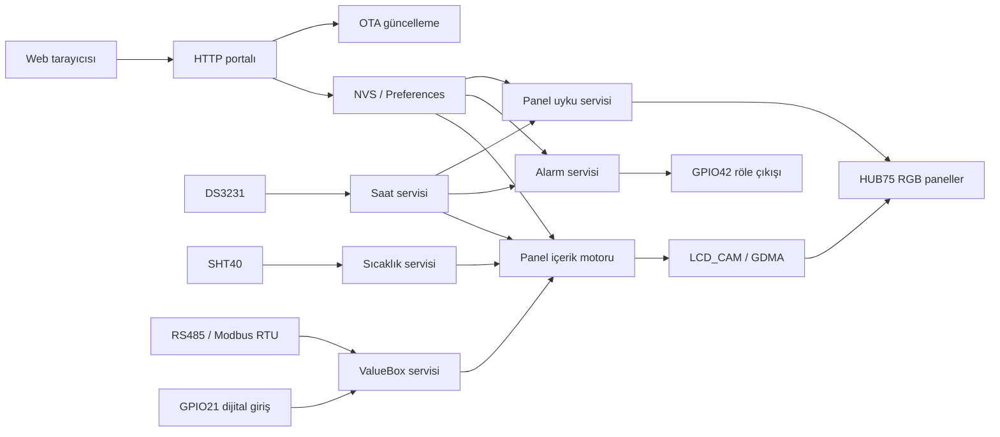

# ESP32-S3 RGB LED Matrix Controller

ESP32-S3 tabanlı, 32×16 HUB75/P10 RGB LED paneller için web arayüzlü kontrol cihazı firmware'idir. Proje; metin, saat, tarih, sıcaklık ve dışarıdan alınan sayısal değerleri bir veya daha fazla panel üzerinde konumlandırabilir. İçerik ayarları sürükle-bırak web editörüyle hazırlanır ve ESP32-S3'ün kalıcı belleğinde saklanır.

Firmware aynı zamanda Modbus RTU slave, dijital giriş sayacı, DS3231 gerçek zaman saati, SHT40 sıcaklık sensörü, programlanabilir alarm rölesi, panel uyku zamanlaması, Wi-Fi erişim noktası ve OTA güncelleme özelliklerini içerir.

## Proje durumu

| Özellik | Değer |
|---|---|
| Firmware sürümü | `0.9.0` |
| Mikrodenetleyici hedefi | ESP32-S3 |
| PlatformIO kartı | `esp32-s3-devkitc1-n8r2` |
| Önerilen modül | ESP32-S3-WROOM-1-N8R2 |
| Flash / PSRAM hedefi | 8 MB Flash / 2 MB PSRAM |
| Framework | Arduino |
| Panel boyutu | 32×16 piksel |
| Desteklenen tarama | 1/4 ve 1/8 scan |
| En fazla yerleşim | 4 satır × 4 sütun, toplam 16 panel |
| Panel başına içerik | En fazla 2 TextBox/ValueBox |
| Web arayüzü dilleri | Türkçe, İngilizce, Almanca, İspanyolca, Arapça |

## Temel özellikler

- 32×16 HUB75/P10 RGB panel desteği
- ESP32-S3 LCD_CAM/GDMA tabanlı paralel panel çıkışı
- 1/4 scan `P10RGB-3535-DP-4S` özel piksel eşlemesi
- 1/8 scan standart iki taramalı panel eşlemesi
- 1×1 ile 4×4 arasında panel yerleşimi
- Sekiz farklı düz ve zigzag panel zincirleme yönü
- Web üzerinde gerçek font bitmap'leriyle piksel hassasiyetinde önizleme
- Sürükle-bırak TextBox ve ValueBox konumlandırma
- 59 Adafruit GFX fontu
- Her font için Türkçe karakterler ve `°` derece işareti
- Saat, tarih, sıcaklık ve metin arasında otomatik içerik döngüsü
- Dört yönde, engellemeyen kayar yazı
- 0°, 90°, 180° ve 270° kutu döndürme
- RGB renk ve kaydırma hızı ayarı
- DS3231 üzerinden pil destekli saat/tarih
- SHT40 üzerinden sıcaklık ölçümü
- Modbus RTU slave üzerinden ValueBox güncelleme
- GPIO21 yükselen kenar sayacı
- En fazla 10 programlanabilir alarm
- Zamanlanmış panel karartma/uyku işlevi
- AP+STA Wi-Fi, captive portal ve bağlantı durum göstergesi
- Web üzerinden `firmware.bin` OTA güncellemesi
- NVS/Preferences üzerinde kalıcı ayarlar ve eski şemaları otomatik yükseltme
- Watchdog ve tekrarlayan hatalı açılışlarda fabrika ayarına dönüş koruması

## Sistem mimarisi



Tüm uygulama servisleri Arduino `loop()` içinde işbirlikçi biçimde güncellenir. HUB75 taraması DMA tarafından yürütüldüğü için ağ, Modbus, sensör ve içerik işlemleri panel yenilemesini doğrudan durdurmaz.

## Gerekli donanım

Temel sistem için aşağıdaki parçalar gerekir:

- ESP32-S3-WROOM-1-N8R2 modülü veya eşdeğer ESP32-S3 kartı
- 32×16 HUB75/P10 RGB LED panel; 1/4 veya 1/8 scan
- HUB75 sinyalleri için tercihen iki adet `74AHCT245` seviye çevirici
- DS3231 RTC ve yedek pili
- SHT40 sıcaklık/nem sensörü
- 3.3 V RS485 transceiver; örneğin ST3485 veya MAX3485 sınıfı
- Alarm çıkışı için MOSFET/transistörlü röle sürücüsü ve flyback diyodu
- Aktif buzzer veya uygun buzzer sürücü katı
- İki durum LED'i ve seri dirençleri
- Dijital giriş için koruma/şekillendirme devresi
- ESP32-S3 için kararlı 3.3 V güç kaynağı
- Panel sayısına ve parlaklığa uygun ayrı 5 V panel güç kaynağı

> HUB75 paneli ESP32-S3'ün 3.3 V regülatöründen beslemeyin. Panel ve kontrol kartı ayrı güç yolları kullanmalı, ancak GND ortak olmalıdır.

## Pin bağlantıları

Pinlerin tek yetkili kaynağı [`include/AppConfig.h`](include/AppConfig.h) dosyasıdır. PCB tasarımı değiştirilirse hem şema hem bu dosya birlikte güncellenmelidir.

### HUB75 panel sinyalleri

| HUB75 sinyali | ESP32-S3 GPIO | Açıklama |
|---|---:|---|
| R1 | GPIO4 | Üst yarı kırmızı veri |
| G1 | GPIO5 | Üst yarı yeşil veri |
| B1 | GPIO6 | Üst yarı mavi veri |
| R2 | GPIO7 | Alt yarı kırmızı veri |
| G2 | GPIO15 | Alt yarı yeşil veri |
| B2 | GPIO16 | Alt yarı mavi veri |
| A | GPIO17 | Satır adresi A |
| B | GPIO18 | Satır adresi B |
| C | GPIO8 | Satır adresi C |
| D | Bağlı değil | Desteklenen 1/4 ve 1/8 panellerde kullanılmıyor |
| E | Bağlı değil | Desteklenen panellerde kullanılmıyor |
| LAT / STB | GPIO9 | Latch/Strobe |
| OE | GPIO10 | Çıkış etkinleştirme, aktif LOW |
| CLK | GPIO11 | Piksel saat sinyali |
| GND | GND | Panel ile ortak referans |

Kütüphane adı `ESP32 HUB75 LED MATRIX PANEL DMA Display` olsa da ESP32-S3 tarafında çıkış grubu LCD_CAM/GDMA paralel çevre birimi üzerinden sürülür. Sabit I²S pinleri yoktur; yukarıdaki GPIO eşlemesi firmware tarafından açıkça verilir.

GPIO8'in `C` adres hattına atanması bilinçlidir. Sinyalleri GPIO numara sırasına göre yeniden dizmeyin.

### I²C, RS485 ve yardımcı giriş/çıkışlar

| İşlev | GPIO | Harici bağlantı | Elektriksel davranış |
|---|---:|---|---|
| I²C SDA | GPIO1 | DS3231 SDA + SHT40 SDA | 3.3 V pull-up gerekir |
| I²C SCL | GPIO2 | DS3231 SCL + SHT40 SCL | 3.3 V pull-up gerekir |
| Buzzer | GPIO14 | Buzzer sürücü girişi | Aktif HIGH, açılışta kısa darbeler |
| AP istemci LED'i | GPIO12 | Direnç → LED → GND | Aktif HIGH, 1 saniye aralıkla yanıp söner |
| STA bağlantı LED'i | GPIO13 | Direnç → LED → GND | Aktif HIGH, 1 saniye aralıkla yanıp söner |
| Alarm rölesi | GPIO42 | Röle sürücü girişi | Aktif HIGH |
| Modbus RX | GPIO39 | RS485 transceiver `RO` | UART1 RX |
| Modbus TX | GPIO40 | RS485 transceiver `DI` | UART1 TX |
| Modbus DIR | GPIO41 | RS485 `DE` + `/RE` | HIGH gönderme, LOW alma |
| Dijital sayaç | GPIO21 | Korunmuş dijital giriş | Dahili pull-down, LOW→HIGH sayımı |

### Programlama ve ayrılması gereken pinler

| İşlev | GPIO | Not |
|---|---:|---|
| USB D− | GPIO19 | Native USB Serial/JTAG |
| USB D+ | GPIO20 | Native USB Serial/JTAG |
| UART0 TX | GPIO43 | Programlama/debug için ayırılabilir |
| UART0 RX | GPIO44 | Programlama/debug için ayırılabilir |
| BOOT | GPIO0 | Pull-up ve GND'ye buton önerilir |
| CHIP_PU / EN | EN | Pull-up, RC gecikme ve reset butonu gerekir |

GPIO0, GPIO3, GPIO45 ve GPIO46 strapping pinleridir. Açılış seviyelerini bozacak güçlü harici sürücüler bağlanmamalıdır. GPIO26–32 Flash/PSRAM için ayrılmıştır. Modül ve bellek çeşidine göre GPIO33–37 de Flash/PSRAM tarafından kullanılabilir.

GPIO39–42 bu projede RS485 ve röle için kullanıldığı için harici pad-JTAG kullanılamaz. GPIO19/20 üzerindeki native USB Serial/JTAG kullanılmaya devam edebilir.

## PCB tasarım notları

### HUB75 çıkışı

- ESP32-S3 GPIO seviyesi 3.3 V'tur. Panel sinyalleri için 5 V ile beslenen `74AHCT245` kullanılması önerilir.
- On iki çıkış sinyali için iki adet sekiz kanallı buffer yeterlidir.
- Buffer yönünü ESP32-S3'ten panele sabitleyin ve kullanılmayan girişleri boşta bırakmayın.
- `OE` aktif LOW olduğu için açılış sırasında paneli kapalı tutacak bir pull-up planlayın.
- `CLK`, `LAT` ve `OE` hatlarında sürücüye yakın `22–47 Ω` seri direnç ayırmak ringing/EMI sorunlarını azaltabilir.
- Panel güç girişine yakın yeterli bulk kapasitör kullanın. Değer, panel sayısı ve maksimum akıma göre hesaplanmalıdır.
- HUB75 konnektörünün fiziksel pin numaralarını yalnızca panel üzerindeki sinyal isimleriyle doğrulayın; farklı üreticilerde konnektör yönü değişebilir.

### I²C

- SDA ve SCL için birer takım yaklaşık `4.7 kΩ` pull-up kullanın.
- Pull-up dirençleri 3.3 V'a bağlanmalıdır.
- Hazır DS3231 modüllerindeki pull-up dirençlerinin 5 V'a bağlı olup olmadığını kontrol edin.
- DS3231 adresi `0x68`, SHT40 varsayılan adresi `0x44` olduğundan iki cihaz aynı bus üzerinde çakışmadan çalışır.

### RS485

- 3.3 V ile çalışan bir RS485 transceiver kullanın.
- GPIO40 → `DI`, GPIO39 ← `RO`, GPIO41 → `DE` ve `/RE` bağlantısı yapılır.
- GPIO41'e yaklaşık `10 kΩ` pull-down eklemek, ESP32-S3 başlatılana kadar transceiver'ı alıcı modunda tutar.
- Hat sonundaysa seçilebilir `120 Ω` terminasyon direnci ekleyin.
- Bias dirençlerini ağ üzerinde yalnızca gerekli noktada kullanın; her cihaza zorunlu olarak eklemeyin.
- A/B konnektöründe GND referansı ve ESD/TVS koruması ayırın.

### Röle, buzzer ve dijital giriş

- Röle bobinini GPIO42'ye doğrudan bağlamayın. MOSFET/transistör, gate/base direnci, pull-down ve flyback diyodu kullanın.
- GPIO42'ye harici pull-down eklemek rölenin açılışta yanlışlıkla tetiklenmesini önler.
- Buzzer akımı GPIO sınırını aşıyorsa GPIO14'ü yalnızca sürücü girişi olarak kullanın.
- GPIO21 yalnızca 3.3 V lojik seviyeyi kabul etmelidir. Harici saha girişi için seri direnç, harici pull-down, Schmitt trigger/optoizolasyon ve ESD koruması değerlendirilmelidir.

### ESP32-S3 besleme, USB ve anten

- ESP32-S3 3.3 V kaynağı en az 500 mA sağlayabilmelidir; Wi-Fi akım darbeleri için pay bırakın.
- Güç girişinde en az `10 µF`, modül yakınında uygun `100 nF` ve ek bulk kapasitörler kullanın.
- `EN/CHIP_PU` boşta bırakılmamalıdır. Tipik başlangıç noktası `10 kΩ` pull-up ve `1 µF` GND kondansatörüdür.
- USB D+/D− hatlarında modüle yakın `22/33 Ω` seri direnç ve konnektöre yakın ESD koruması ayırın.
- USB-C device tasarımında CC1 ve CC2 pinlerinin her birine ayrı `5.1 kΩ` GND direnci gerekir.
- WROOM PCB antenini kart kenarına yerleştirin. Anten altında/önünde tüm katmanlarda bakır, iz ve komponent keep-out alanı bırakın.

Başvuru belgeleri:

- [ESP32-S3 Hardware Design Guidelines](https://docs.espressif.com/projects/esp-hardware-design-guidelines/en/latest/esp32s3/)
- [ESP32-S3 GPIO açıklamaları](https://docs.espressif.com/projects/esp-idf/en/stable/esp32s3/api-reference/peripherals/gpio.html)
- [ESP32-S3-WROOM-1 / WROOM-1U datasheet](https://documentation.espressif.com/esp32-s3-wroom-1_wroom-1u_datasheet_en.pdf)

## Varsayılan çalışma ayarları

İlk açılışta veya fabrika ayarına dönüşten sonra aşağıdaki değerler kullanılır:

| Ayar | Varsayılan |
|---|---|
| Panel tarama | Derleme sırasındaki `PANEL_SCAN_DIVISOR`, varsayılan 1/4 |
| Panel yerleşimi | 1 satır × 1 sütun |
| Panel bağlantı yönü | Sağ üstten aşağı |
| Parlaklık | 64 / 255 |
| Başlangıç içeriği | Kırmızı saat |
| Saat konumu | X=1, Y=3 |
| Varsayılan font | GohuFont6x11 |
| AP SSID | `STEP-RGB` |
| AP parolası | `00000000` |
| AP adresi | `192.168.4.1` |
| AP kanalı | 1 |
| En fazla AP istemcisi | 4 |
| STA | Devre dışı; SSID boş |
| Modbus slave adresi | 1 |
| Modbus seri ayarı | 115200 baud, 8N1 |
| RS485 yön kontrolü | Etkin |
| Panel uyku zamanı | Devre dışı; kayıtlı varsayılan aralık 23:00–07:00 |
| Alarmlar | Boş |
| Seri monitör | 115200 baud |
| Watchdog | 20 saniye |

Varsayılan AP parolası yalnızca ilk kurulum içindir. Cihazı devreye aldıktan sonra web arayüzünden değiştirilmelidir.

## İlk kurulum

1. Donanım bağlantılarını ve özellikle ortak GND'yi kontrol edin.
2. Firmware'i USB veya UART üzerinden ESP32-S3'e yükleyin.
3. Telefon/bilgisayardan `STEP-RGB` Wi-Fi ağına bağlanın.
4. Varsayılan parola olarak `00000000` kullanın.
5. Captive portal otomatik açılmazsa `http://192.168.4.1/` adresini açın.
6. Ayarlar sayfasından panel scan oranını, satır/sütun sayısını ve fiziksel zincirleme yönünü seçin.
7. Kırmızı, yeşil ve mavi panel testlerini çalıştırarak renk/sinyal bağlantılarını doğrulayın.
8. Saat/tarih, Wi-Fi STA, Modbus ve alarm ayarlarını yapılandırın.
9. Ana editörden TextBox/ValueBox öğelerini ekleyip panele uygulayın.

Panel, Wi-Fi ve haberleşme gibi donanım seviyesini etkileyen bazı ayarlar kaydedildikten sonra cihaz kontrollü olarak yeniden başlar.

## Web arayüzü

### Ana içerik editörü

Ana sayfa aşağıdaki işlemleri sağlar:

- Fiziksel panel yerleşiminin görsel önizlemesi
- Düzenlenecek panelin seçilmesi
- TextBox veya ValueBox eklenmesi
- Öğenin fare veya dokunmatik ekranla sürüklenmesi
- Font, renk, dönüş, konum ve kaydırma ayarı
- Panel başına doluluk göstergesi
- Tasarımın flash belleğe kaydedilmesi

Editör önizlemesi fontları tarayıcı sistem fontlarıyla taklit etmez. Cihazdaki gerçek Adafruit GFX bitmap ve glif metrikleri `/api/font` üzerinden alınır; bu nedenle web önizlemesi ile fiziksel panel konumu aynı koordinat sistemini kullanır.

### TextBox

TextBox aşağıdaki içerik türlerini gösterebilir:

- Sabit metin
- Saat
- Tarih
- SHT40 sıcaklığı

İçerik döngüsü etkinleştirilirse seçilen türler `Yazı → Saat → Tarih → Sıcaklık` sırasıyla gösterilir. Geçiş süresi 1–3600 saniye arasında seçilebilir. Kayar yazı açıkken içerik geçişi, mevcut içeriğin tam turu tamamlandıktan sonra yapılır.

Metin alanının dahili kapasitesi 48 byte'tır; sonlandırıcı nedeniyle kullanıcı metni en fazla 47 UTF-8 byte olabilir. Türkçe karakterlerin birden fazla UTF-8 byte kullanabileceği unutulmamalıdır.

### ValueBox

ValueBox iki kaynaktan değer alabilir:

1. Modbus RTU holding register
2. GPIO21 dijital giriş sayacı

Modbus kaynağında signed 16-bit integer veya IEEE-754 float seçilebilir. Dijital giriş kaynağında yukarı/aşağı sayma ve 32-bit başlangıç değeri ayarlanabilir. Cihaz yeniden başladığında çalışma değeri kayıtlı başlangıç değerinden başlar; runtime Modbus/sayaç değeri NVS'ye sürekli yazılmaz.

### Ayarlar sayfası

Ayarlar ekranı şu grupları içerir:

- Panel tarama, boyut, parlaklık ve zincirleme yönü
- RGB panel testi
- DS3231 saat/tarih ayarı
- Telefon/bilgisayar saatini kullanma
- Panel uyku zamanlaması
- Alarm listesi
- UART/Modbus haberleşme ayarları
- Wi-Fi AP ve STA ayarları
- STA bağlantı durumu, IP ve sinyal kalitesi
- OTA firmware güncellemesi

### Dil desteği

Web arayüzü Türkçe, İngilizce, Almanca, İspanyolca ve Arapça dillerini destekler. İlk açılışta desteklenen tarayıcı dili algılanır. Seçim tarayıcının `localStorage` alanında saklanır; farklı telefon veya bilgisayarlarda dil tercihi ayrı olabilir.

Arapçada sayfa RTL düzenine geçer. Panel koordinat sistemi, bağlantı şekilleri, sayısal alanlar ve piksel önizlemesi teknik doğruluğu korumak için LTR kalır.

## Font sistemi

Firmware toplam 59 font içerir:

- Apple4x6, Apple5x7, Apple6x10, Apple8x13
- GohuFont6x11 ve GohuFont6x11b
- Fixed
- FreeMono ailesi; normal, bold ve oblique, 9/12/18/24 pt
- FreeSans ailesi; normal, bold ve oblique, 9/12/18/24 pt
- FreeSerif ailesi; normal, bold ve italic, 9/12/18/24 pt
- Org_01, Picopixel, Tiny3x3a2pt7b ve TomThumb

Her fontun `Ç Ğ İ Ö Ş Ü ç ğ ı ö ş ü` karakterleri ve derece işareti fonta özgü bitmap olarak üretilmiştir. `℃` karakteri derece glifi ile `C` karakterinin birleşimi şeklinde gösterilir.

Font kataloğu [`lib/Fonts/FontCatalog.cpp`](lib/Fonts/FontCatalog.cpp), üretilmiş Türkçe glifler ise [`lib/Fonts/FontTurkishExtensions.generated.h`](lib/Fonts/FontTurkishExtensions.generated.h) içindedir.

Türkçe font uzantılarını yeniden üretmek için GNU FreeFont TTF dosyaları ve Pillow gerekir:

```bash
python tools/generate_turkish_font_extensions.py \
  --freefont-dir /path/to/freefont-ttf \
  --preview /tmp/font-preview.png
```

`FontTurkishExtensions.generated.h` dosyası elle düzenlenmemelidir. Fonta özgü düzeltmeler üretici betiğine eklenmeli, ardından başlık yeniden üretilmelidir.

## Modbus RTU slave

### Fiziksel bağlantı

| RS485 transceiver | ESP32-S3 |
|---|---|
| RO | GPIO39 / UART1 RX |
| DI | GPIO40 / UART1 TX |
| DE + `/RE` | GPIO41 / DIR |

### Varsayılan iletişim

- Slave ID: `1`
- Baudrate: `115200`
- Veri formatı: `8N1`
- Stop bit: sabit `1`
- Yön kontrolü: GPIO41 ile manuel RS485 DIR

Web arayüzünün **Haberleşme Ayarları** bölümünde Slave ID `1–247` aralığında elle girilebilir. Aynı bölümden baudrate `4800`, `9600`, `19200`, `57600` veya `115200`; data size 5–8 bit; parity None/Even/Odd olarak seçilebilir. Ayarlar NVS içinde saklanır ve kayıt sonrasında cihaz yeni iletişim ayarlarıyla yeniden başlar.

### Desteklenen fonksiyonlar

| Fonksiyon | Kod | Davranış |
|---|---:|---|
| Read Holding Registers | `0x03` | ValueBox register değerlerini okur |
| Write Single Register | `0x06` | Tek register yazar |
| Write Multiple Registers | `0x10` | Ardışık register yazar |

Bir okumada/yazmada en fazla 64 register işlenir. Standart Modbus exception kodları kullanılır:

- `0x01`: Illegal Function
- `0x02`: Illegal Data Address
- `0x03`: Illegal Data Value

Adres `0` broadcast yazmaları kabul edilir ve broadcast isteğine cevap gönderilmez. Broadcast read isteği işlenmez.

### Register eşlemesi

Firmware'de sabit, global bir register tablosu yoktur. Her Modbus ValueBox için holding register adresi web editöründe kullanıcı tarafından seçilir.

| ValueBox tipi | Kullanılan register | Veri gösterimi |
|---|---:|---|
| Signed integer 16-bit | 1 | İki tamamlayan signed `int16_t` |
| IEEE-754 float | 2 | İlk register yüksek word, ikinci register düşük word |

Float değerlerde word sırası `High Word → Low Word` şeklindedir. Her Modbus register içindeki byte sırası standart Modbus big-endian düzenindedir. Float ValueBox adresi `65535` olamaz ve iki ValueBox register aralığı çakışamaz.

Örnek: float ValueBox başlangıç adresi `100` ise:

- Register `100`: IEEE-754 bitlerinin üst 16 biti
- Register `101`: IEEE-754 bitlerinin alt 16 biti

Modbus ile gelen değer yalnızca çalışma belleğinde tutulur. Yeniden başlatmada ValueBox, web arayüzünde tanımlanan başlangıç değerine döner.

## Dijital giriş sayacı

GPIO21 dahili pull-down ile LOW seviyesinde bekler. Debounce süresi 30 ms'dir. Kararlı bir `LOW → HIGH` kenarı geldiğinde dijital giriş kaynağını kullanan ValueBox öğeleri yön ayarına göre bir artırılır veya azaltılır.

- Sayaç türü: signed 32-bit
- Aralık: `-2147483648` … `2147483647`
- Taşma yerine sınırda durur
- Negatif değerler panelde gösterilebilir
- Birden fazla dijital ValueBox aynı fiziksel kenarı birlikte işler

## Saat, sıcaklık, alarm ve panel uyku işlevi

### DS3231

DS3231 her 100 ms'de bir okunur. RTC bulunamazsa saat, alarm ve zamanlamaya bağlı işlevler hazır duruma geçmez. RTC güç kaybı algılanırsa ilk açılışta firmware derleme tarih/saatine ayarlanır; daha sonra web arayüzünden doğru zaman girilmelidir.

### SHT40

SHT40 yaklaşık 2 saniyede bir yüksek hassasiyetli ölçüm başlatır. Sensör bulunamaz veya haberleşme kesilirse yeniden algılama denenir ve sıcaklık içeriğinde `TMP?` gösterilir.

Sıcaklık iki biçimde gösterilebilir:

- Bir ondalıklı float, örneğin `23.5°C`
- En yakın tam sayıya yuvarlanmış integer, örneğin `24°C`

### Alarm

- En fazla 10 alarm
- 1–3600 saniye röle aktif kalma süresi
- Her gün, hafta içi veya kullanıcı tarafından seçilen günler
- Aynı alarm aynı takvim gününde bir kez tetiklenir
- Çakışan alarm sürelerinde röle kapanış zamanı daha ileri olana uzatılır
- GPIO42 aktif HIGH çalışır

### Panel uyku zamanlaması

Uyku işlevi ESP32-S3'ü kapatmaz; yalnızca panel parlaklığını sıfıra indirir. Wi-Fi, web portalı, Modbus, sensörler ve alarmlar çalışmaya devam eder.

Uyku başlangıcı her gün uygulanır. Açılma zamanı “her gün” veya “yalnızca hafta içi” seçimine uyar. Örneğin cuma 23:00'te kararan panel, hafta içi seçiliyse pazartesi 07:00'de yeniden açılabilir.

RGB panel testi sırasında geçici uyanma uygulanır; test bittikten sonra zamanlanmış parlaklık durumu geri yüklenir.

## Wi-Fi ve captive portal

Cihaz sürekli `WIFI_AP_STA` modunda çalışır:

- Yerel erişim noktası her zaman web arayüzüne erişim sağlar.
- Captive DNS bütün alan adlarını `192.168.4.1` adresine yönlendirir.
- Kaydedilmiş STA SSID varsa cihaz harici 2.4 GHz Wi-Fi ağına bağlanmayı dener.
- STA denemesi her 60 saniyede bir başlar ve en fazla 10 saniye sürer.
- Yerel AP'ye aktif bir istemci bağlıyken portal bağlantısını korumak için yeni STA denemeleri bekletilir.
- Başarısız STA taramasından sonra SoftAP sağlığı kontrol edilir ve gerekirse yeniden başlatılır.
- Wi-Fi sleep kapalıdır.
- STA otomatik reconnect yerine firmware tarafından kontrollü biçimde yönetilir.

ESP32-S3 yalnızca 2.4 GHz Wi-Fi destekler. STA ağı 5 GHz-only olmamalıdır.

Web arayüzü HTTP kullanır ve ayrıca kullanıcı hesabı/oturum doğrulaması içermez. STA ile kurumsal veya ev ağına bağlandığında cihaz portalına aynı ağdaki istemciler erişebilir. Cihaz güvenilmeyen bir ağa doğrudan bağlanmamalı ve varsayılan AP parolası değiştirilmelidir.

## OTA firmware güncellemesi

1. PlatformIO ile projeyi derleyin.
2. `.pio/build/esp32-s3-devkitc1-n8r2/firmware.bin` dosyasını bulun.
3. Dosyanın adının tam olarak `firmware.bin` olduğundan emin olun.
4. Web arayüzünde **Ayarlar → Yazılım Güncelleme** bölümünü açın.
5. Dosyayı seçip güncellemeyi başlatın.
6. Doğrulama tamamlandığında cihaz otomatik yeniden başlar.

OTA sırasında cihazın ve panelin beslemesini kesmeyin. Firmware güncelleme servisi uzun flash işlemleri sırasında watchdog'u besler.

## Kalıcı ayarlar ve güvenli açılış

Panel, ağ, UART, uyku, alarm ve içerik ayarları ESP32 Preferences/NVS içinde `step-rgb` namespace'i altında tutulur.

İçerik ayarları şema sürümü 6'dır. Eski içerik şemaları 1–5 arasında algılanıp yeni yapıya taşınır. Alarm şeması sürüm 2'dir ve eski tekrar ayarları gün maskesine yükseltilir. Geçersiz veya eksik NVS verileri güvenli varsayılanlarla onarılır.

Boot guard her açılışı sayar. Cihaz 60 saniye kararlı çalışınca sayaç temizlenir. Beşten fazla art arda kararsız açılış algılanırsa ayarlar fabrika varsayılanlarına döndürülür. Web arayüzünün planladığı normal yeniden başlatmalarda sayaç önceden temizlenir.

## HTTP uç noktaları

Bu uç noktalar web arayüzünün dahili API'sidir; sürümler arasında değişebilir.

| Metot | Yol | Açıklama |
|---|---|---|
| GET | `/` | Panel içerik editörü |
| GET | `/settings` | Ayarlar sayfası |
| GET | `/i18n.js` | Sıkıştırılmış dil paketi |
| GET | `/firmware.js` | Firmware sürümünü sayfaya işler |
| GET | `/api/settings` | Tüm ayarları JSON döndürür |
| GET | `/api/wifi/status` | STA durum/IP/RSSI bilgisini döndürür |
| GET | `/api/content` | Panel içerik modelini döndürür |
| POST | `/api/content` | İçerik tasarımını doğrular ve kaydeder |
| GET | `/api/font?id=N` | Font bitmap ve glif metriklerini döndürür |
| GET | `/api/temperature` | Sıcaklık durumunu döndürür |
| POST | `/api/settings/panel` | Panel ayarlarını kaydeder |
| POST | `/api/settings/clock` | Saat/tarih ve uyku ayarlarını kaydeder |
| POST | `/api/settings/alarms` | Alarm listesini kaydeder |
| POST | `/api/settings/communication` | Slave ID ve UART/RS485 ayarlarını kaydeder |
| POST | `/api/settings/wifi` | AP/STA ayarlarını kaydeder |
| POST | `/api/panel/test?color=red|green|blue` | 750 ms renk testi başlatır |
| POST | `/api/firmware/update` | `firmware.bin` OTA yüklemesi |

HTML, çeviri betiği ve font verileri cihazdan `no-store` başlıklarıyla sunulur. Ana HTML ve dil paketi Flash içinde gzip sıkıştırılmış olarak saklanır.

## Derleme

### Gereksinimler

- Visual Studio Code + PlatformIO eklentisi veya PlatformIO Core
- Node.js; portal varlıklarını yeniden üretmek için
- USB veya UART bağlantısı

Bağımlılıklar [`platformio.ini`](platformio.ini) tarafından otomatik indirilir:

- ESP32 HUB75 LED MATRIX PANEL DMA Display `^3.0.15`
- FastLED `^3.10.3`
- Adafruit GFX Library `^1.12.6`
- RTClib `^2.1.4`
- Proje içi SHT40 sürücüsü

### PlatformIO komutları

Projeyi derlemek:

```bash
pio run
```

USB üzerinden yüklemek:

```bash
pio run --target upload
```

Seri monitörü açmak:

```bash
pio device monitor --baud 115200
```

Temiz derleme:

```bash
pio run --target clean
pio run
```

Üretilen OTA dosyası:

```text
.pio/build/esp32-s3-devkitc1-n8r2/firmware.bin
```

### Panel scan varsayılanını derleme sırasında değiştirme

Varsayılan scan değeri 1/4'tür. Derleme bayrağı ile 1/8 seçilebilir:

```ini
build_flags = -DPANEL_SCAN_DIVISOR=8
```

Yalnızca `4` veya `8` kabul edilir. Kaydedilmiş geçerli panel ayarı varsa NVS değeri derleme varsayılanının önüne geçer.

## Web portalı kaynaklarını yeniden üretme

Portal HTML kaynakları [`include/PortalPage.h`](include/PortalPage.h), dil paketi [`web/portal-i18n.js`](web/portal-i18n.js) içindedir. Bunlar firmware'e eklenmeden önce gzip ile sıkıştırılır:

```bash
node tools/generate_portal_compressed.mjs
```

Betik:

1. `homeHtml` ve `settingsHtml` içeriklerini yeniden kurar.
2. Firmware sürümünü HTML'e yerleştirir.
3. Inline JavaScript ve çeviri betiği sözdizimini doğrular.
4. HTML/JavaScript dosyalarını gzip ile sıkıştırır.
5. [`include/PortalCompressed.h`](include/PortalCompressed.h) dosyasını üretir.

`PortalPage.h`, `portal-i18n.js` veya firmware sürümü değiştirildiğinde bu komut yeniden çalıştırılmalıdır. `PortalCompressed.h` elle düzenlenmemelidir.

## Proje dizin yapısı

```text
ESP32_S3_LedMatrix_Controller/
├── include/
│   ├── AppConfig.h                 # Pinler ve sabit çalışma değerleri
│   ├── ContentModel.h              # TextBox/ValueBox veri modeli
│   ├── PortalPage.h                # Web arayüzü HTML/CSS/JavaScript
│   ├── PortalCompressed.h          # Üretilmiş gzip web varlıkları
│   └── ...                         # Servis ve uygulama başlıkları
├── lib/
│   ├── Fonts/                      # Font kataloğu ve Türkçe glifler
│   └── SHT40/                      # Proje içi SHT40 sürücüsü
├── src/
│   ├── main.cpp                    # Servis oluşturma ve ana döngü
│   ├── PanelDisplay.cpp            # HUB75 DMA ve panel eşleme
│   ├── PanelContentApplication.cpp # İçerik çizimi/kaydırma
│   ├── PortalApplication.cpp       # HTTP portalı ve API'ler
│   ├── ModbusRtuSlaveService.cpp   # Modbus RTU slave
│   ├── SettingsService.cpp         # NVS, doğrulama ve migration
│   └── ...
├── tools/
│   ├── generate_portal_compressed.mjs
│   └── generate_turkish_font_extensions.py
├── web/
│   └── portal-i18n.js              # Beş dilli çeviri paketi
└── platformio.ini
```

## Sorun giderme

### Panel hiç yanmıyor

- Panel 5 V beslemesini ve ortak GND'yi kontrol edin.
- `OE`, `LAT` ve `CLK` bağlantılarını doğrulayın.
- Seviye çeviricinin yön ve enable pinlerini kontrol edin.
- Web arayüzündeki parlaklık değerinin sıfır olmadığını kontrol edin.
- Panel uyku zamanlamasının aktif olup olmadığını kontrol edin.
- RGB renk testini çalıştırın.

### Görüntü karışık veya satırlar yanlış

- Panelin 1/4 mü 1/8 scan mi olduğunu doğrulayın.
- Panel bağlantı yönünü ve zigzag seçimini değiştirerek test edin.
- P10RGB-3535-DP-4S panel için 1/4 scan seçin.
- HUB75 A/B/C adres hatlarını ve özellikle `C → GPIO8` bağlantısını kontrol edin.
- CLK/LAT hatlarında uzun kablo, ringing ve yetersiz GND dönüşünü kontrol edin.

### Renkler yanlış

- Kırmızı, yeşil ve mavi web testlerini ayrı ayrı çalıştırın.
- R1/G1/B1 ve R2/G2/B2 sıralamasını kontrol edin.
- Panel konnektör yönünü yalnızca kablo çentiğine bakarak varsaymayın; sinyal etiketlerini ölçün.

### Web arayüzü açılmıyor

- `STEP-RGB` ağına bağlı olduğunuzu kontrol edin.
- `http://192.168.4.1/` adresini doğrudan açın.
- Mobil veriyi geçici olarak kapatın veya cihazın internetsiz Wi-Fi ağında kalmasına izin verin.
- AP durum LED'ini ve 115200 baud seri logları kontrol edin.
- STA denemeleri aktif AP istemcisi varken otomatik olarak bekletilir; bu normaldir.

### STA ağına bağlanmıyor

- Ağın 2.4 GHz yayın yaptığını doğrulayın.
- SSID ve parolayı kontrol edin.
- AP istemcisi bağlıyken STA denemelerinin bekletildiğini unutmayın.
- Ayarlar ekranındaki durum, geri sayım, RSSI ve hata açıklamasını kontrol edin.

### Modbus cevap vermiyor

- Master'daki Slave ID ile web arayüzünün Haberleşme Ayarları bölümündeki Slave ID'nin aynı olduğunu doğrulayın.
- Baudrate, data bit ve parity değerlerini eşleştirin; stop bit daima 1'dir.
- A/B polaritesini ve ortak GND'yi kontrol edin.
- GPIO41'in transceiver `DE` ve `/RE` pinlerine bağlı olduğunu kontrol edin.
- Master'ın yalnızca web arayüzünde ValueBox'a atanmış register adreslerini kullandığını doğrulayın.
- Float değerlerde iki ardışık register ve high-word-first sırasını kullanın.

### Saat veya sıcaklık görünmüyor

- I²C pull-up dirençlerinin 3.3 V'a bağlı olduğunu kontrol edin.
- DS3231 için `0x68`, SHT40 için `0x44` adresini tarayın.
- Hazır sensör modüllerinin 5 V pull-up içermediğini doğrulayın.
- Seri loglarda `DS3231 not found` veya `SHT40 not found` mesajını kontrol edin.

### Cihaz sürekli yeniden başlıyor

- 3.3 V kaynağın Wi-Fi akım darbelerinde çökmediğini ölçün.
- Panel akımının ESP32-S3 regülatöründen geçmediğini doğrulayın.
- EN/CHIP_PU RC devresini ve strapping pin seviyelerini kontrol edin.
- Seri monitörde reset nedenini inceleyin.
- Boot guard, tekrarlayan başarısız açılışlardan sonra güvenli varsayılanları otomatik yükleyebilir.

## Bilinen sınırlar

- Yalnızca 32×16, 1/4 veya 1/8 scan panel düzenleri desteklenir.
- D/E satır adresi gerektiren 1/16 ve 1/32 scan paneller mevcut pin planıyla desteklenmez.
- En fazla 4×4 panel ve panel başına 2 içerik kutusu kullanılabilir.
- Toplam içerik kapasitesi en fazla 32 kutudur.
- TextBox metni en fazla 47 UTF-8 byte olabilir.
- Runtime Modbus/sayaç değerleri yeniden başlatmalar arasında saklanmaz.
- Portal HTTP üzerinden çalışır ve kullanıcı bazlı kimlik doğrulama içermez.

## Lisans ve üçüncü taraf bileşenler

Proje kökünde henüz genel bir lisans dosyası bulunmamaktadır. Kaynak kodunu dağıtmadan önce proje için uygun bir `LICENSE` dosyası eklenmelidir.

PlatformIO bağımlılıkları ve `lib/Fonts` içindeki font kaynakları kendi lisans/başlık koşullarına tabidir. Üretilmiş GNU FreeFont glifleri GNU GPL font embedding exception bilgisini korur. Dağıtım yapılırken ilgili kütüphane ve font başlıklarındaki lisans metinleri ayrıca kontrol edilmelidir.
